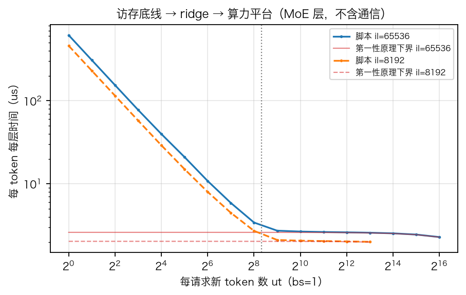
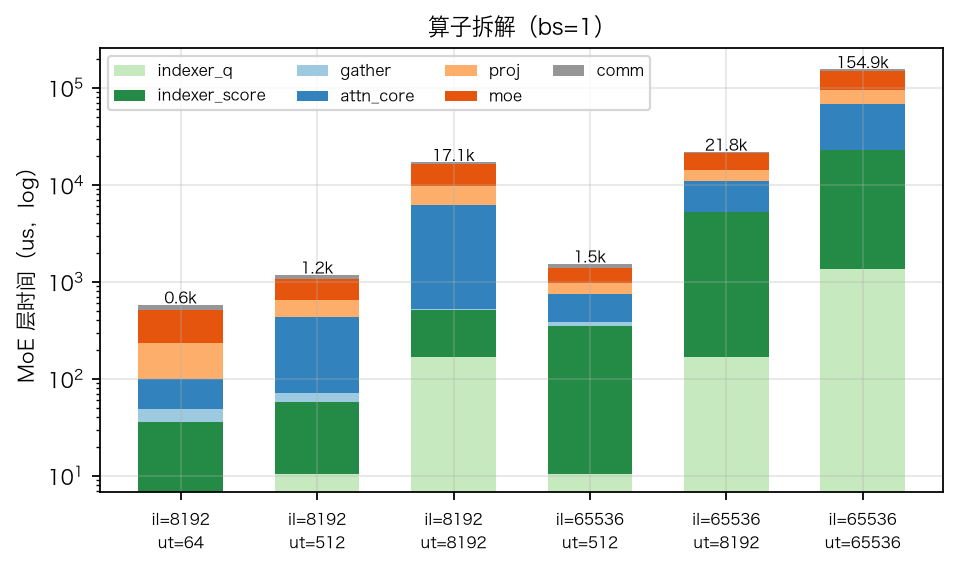
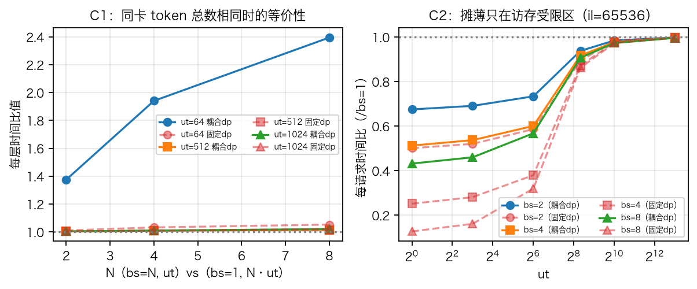
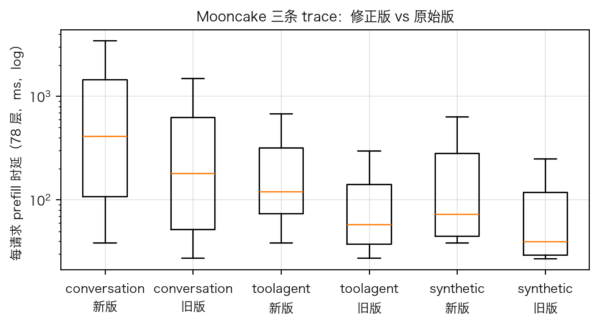

# prefill_time 计算时间仿真合理性验证

| 项 | 内容 |
|---|---|
| 日期 | 2026-10-21 |
| 对象 | `prefill_time/prefill_time_single.py`（单请求）、`prefill_time/prefill_time_batch.py`（任意每卡 bs） |
| 验证脚本 | `prefill_time/validate_prefill_time.py`（本文所有表与图由它一次生成，可重跑） |
| 对照基线 | 原始 GBK 抄录版（git `bd8422d`，脚本从 git 直接读取做新旧对比） |
| 模型/硬件 | GLM5（78 层 = 3 dense + 75 MoE，MLA + DSA 稀疏注意力 top-2048，256 路由专家激活 8）on 32×D950PR（FP8 1024 / FP16 512 TFLOPS，HBM 1600 GB/s，prefill 折扣 0.8） |
| 回归 | 全量 `pytest tests/` 240 passed（488 s）；本次改动只在 `prefill_time/`，不被 `sim/`、`tests/` 引用 |

## 总判决

**Go（有条件）。** 修正后的脚本是一个**自洽的 kernel 级 roofline 估算器**，对 bs=1 与 bs≠1 都成立：

1. 每层每 token 的 FLOPs 与第一性原理逐项吻合，算力受限区脚本时间 / 理论下界 = 1.000–1.07（超出部分是可解释的固定开销）。
2. 随 token 数呈正确的三段式：权重读底线 → ridge（理论值 F/(2B)=320 token，曲线拐点落在同处）→ 算力平台。
3. bs≠1 语义自洽：每卡 MoE 计算量只随 nq=bs·ut 走（守恒式逐 bs 核对）；"N 个请求×ut"与"1 个请求×N·ut"在算力受限区等价（比值 1.00–1.05）；摊薄收益只在访存受限区兑现，与 LLM 服务常识一致。
4. kernel 级外部锚点吻合：模型 FP16 有效算力 409.6 TFLOPS 与 FlashMLA 稀疏 prefill 在昇腾 950 的实测 410 TFLOPS（95% 峰值）同值。

**条件**：它是 kernel 级下界——0.8 效率、通信只含 dispatch/combine 的 nvlink 项，不含 EP 负载不均、调度空洞、流水气泡。对照 DeepSeek-V3 生产集群（同为 MLA+256 专家 MoE、激活参数 37B vs GLM5 约 40B）的公开吞吐，生产系统级 MFU 约 20–30%，模型等效 63%，即**绝对时延偏乐观约 2–3 倍**。用于策略间的相对比较、排序、瓶颈归因是可靠的；要绝对值需按实测校准 `prefill_discount_cal/mem`。

**本次验证顺带发现并修了两处结构性缺失**（F10、F11，见 §1）：原版 DSA 层没算 MLA 的线性投影（每 token 每层 332 MFLOP，占线性层 1/3），注意力核心用 MHA 口径算 FLOPs 却读 absorb 口径的 576 维潜 KV。因此本文结论对应 commit 之后的版本；对 Mooncake trace 的 prefill 时延估计相对原始抄录版整体上调 2.4 倍。

## 1. 模型口径与修正清单

两个 trace 字段决定一切：`input_length` → 上下文全长 il（含本次新 token），`u_tokens` → 本次要算的新 token 数 ut（缓存未命中部分）。每层时间 = indexer 两段 + gather + 稀疏注意力核心 + MLA 投影 + MoE/MLP + 通信，每个算子按 roofline `max(FLOPs/算力, 字节/带宽)` 再叠 pipeline 下限与 kernel 启动开销。

bs 语义继承外部 TestConfig：bs 是**每卡**请求数，dp = 32//bs、ep = dp，全局并发恒 32 重打包——bs 变大意味着用更少的卡、每卡本地专家数×bs，不是"更大的全局 batch"。§5 对两种语义都做了核对。

| 编号 | 修正 | 对结果的影响 | 依据 |
|---|---|---|---|
| F1 | 注意力/索引路径加 `new_query_len`（原版是 decode 单 query 语义） | 决定性：prefill 注意力从常数变为 ∝ ut | arXiv:2512.02556；vLLM 博文；FlashMLA indices `[s_q,h_kv,topk]` |
| F2 | 注意力 KV 读取按上下文并集 `min(ut·topk, il)`（可开关 `kv_hbm_reuse`） | 无复用上界会大 30–40 倍且不物理 | FlashMLA prefill 640 TFLOPS ⇒ 算力瓶颈 |
| F4 | dense 层去掉不存在的 MoE dispatch/combine | 3/78 层，小 | 结构常识 |
| F5 | 字节统一十进制 GB（原版 1024³ 折算却按 GB/s 除） | 访存项 +7.4% | 单位一致性 |
| F6 | indexer 扫描长度取因果中点 il−ut/2 | 首轮长 prefill 的 indexer 二次项 ÷2 | vLLM 博文因果性描述 |
| F9 | indexer 打分写回按每 (q,k) 一个标量（head 归约在 kernel 内） | 长上下文主导项 ÷16；该项变为纯算力受限 | DeepGEMM README mqa_logits |
| **F10** | **补 MLA 线性投影**（q_a/q_b/W_UK 吸收/kv_a/W_UV/o + indexer K） | **每 token 每层 +332 MFLOP** | arXiv:2412.19437 §2.1.1 |
| **F11** | **注意力核心改 absorb 口径**（d_qk=576、d_v=512） | **核心 FLOPs ×2.1** | FlashMLA `flash_mla_sparse_fwd` API |
| F3/F7/F8 | rope 维度（并入 F11）/ max_batch_size 告警 / 路径修正 | 无数值影响 | — |

## 2. 第一性原理复算（§A）

独立于脚本公式，按教科书方式数 GLM5 一层每 token 的 FLOPs（absorb MLA + DSA + MoE），再看脚本在算力受限区是否复现它。

| 组件（每 token 每层） | MFLOP | 精度 | 说明 |
|---|---|---|---|
| indexer_q 投影 2048→4096 | 16.8 | FP8 | lightning indexer 的 query 投影 |
| indexer_k 投影 6144→128 | 1.6 | FP8 | 为新 token 生成 128 维索引 K |
| indexer_score 打分 | 65.0（il=8k）/ 536（il=64k） | FP8 | 2×4096×上下文，唯一的 ut×il 二次项 |
| proj MLA 六个投影 | 330.0 | FP8 | q_a 25 + q_b 67 + W_UK 13 + kv_a 7 + W_UV 17 + o 201 |
| attn_core 稀疏注意力 | 285.2 | FP16 | 2×64 头×2048×(576+512) |
| moe 8 路由 + 1 共享 | 679.5 | FP8 | 9×3×2×6144×2048 |
| mlp（dense 层代替 moe） | 453.0 | FP8 | 3×2×6144×12288 |

MoE 层合计 1378 MFLOP/token（il=8k），线性部分折合**激活参数 39.7B**，与 DeepSeek-V3 的 37B 同量级——数量级先对上了。

**脚本时间 ÷ 第一性原理下界（FLOPs÷有效算力）**：

| 工况 | idx_q | idx_score | proj | attn | moe | 整层 |
|---|---|---|---|---|---|---|
| il=8192, ut=8192 | 1.000 | 1.021 | 1.023 | 1.001 | 1.000 | 1.006 |
| il=65536, ut=65536 | 1.000 | 1.000 | 1.021 | 1.000 | 1.000 | 1.004 |
| il=65536, ut=512 | 1.000 | 1.021 | 1.071 | 1.020 | 1.000 | 1.049 |

读法：比值恰为 1.000 的算子说明脚本的 FLOPs 计数与教科书完全一致（时间就是 FLOPs÷算力）；1.02 来自每 128 条一个 tile 的 pipeline 下限与一次 kernel 启动；proj 的 1.07 来自 W_UV 这个"宽中间层"GEMM（每 token 输入 64×512 个激活）在 512 token 时仍是访存受限——这是物理的，不是误差。

**访存侧**：每层每 NPU 权重（FP8，bs=1）= indexer 9 MB + proj 165 MB + 专家 340 MB = 514 MB → 读一遍 402 us。ut=1 时脚本给 616 us，差额 35% 是 pipeline 下限/kernel 启动/索引 K 扫描的固定开销——即"上限 + 开销"两段都能对上。

## 3. 极限行为：三段式与 ridge（§B）

读法：横轴每请求新 token 数 ut（bs=1），纵轴每 token 每层时间（us，双对数）。实线/虚线为脚本（il=65536/8192），红线为第一性原理下界。左段随 1/ut 下降（权重读被摊薄，访存受限），右段平台（算力受限，脚本与红线重合），拐点落在灰色竖线 ut=320 附近。

| il | ut | 脚本 us/token/层 | 下界 | 比值 | 所处区 |
|---|---|---|---|---|---|
| 65536 | 1 | 616.4 | 2.61 | 236 | 访存受限（decode 退化） |
| 65536 | 64 | 10.8 | 2.61 | 4.15 | 过渡 |
| 65536 | 320 | 3.02 | 2.60 | 1.16 | ridge |
| 65536 | 1024 | 2.67 | 2.60 | 1.03 | 算力受限 |
| 65536 | 65536 | 2.29 | 2.28 | 1.00 | 算力受限 |

ridge 的理论值：FP8 GEMM 的算术强度是 2·M FLOP/byte（M 为 token 数），与 in×out 形状无关，故 ridge 在 M* = F/(2B) = 819.2e12/(2×1280e9) = **320 token**——对 MoE 是每专家 token 数（bs=1 下恰等于 ut），对复制权重（proj/indexer）是 bs·ut。曲线在 320 处比值 1.16、1024 处 1.03，与解析值一致。

## 4. 算子拆解（bs=1）

| il | ut | idx_q | idx_score | gather | attn_core | proj | moe | comm | 层合计 us | 注意力+索引占比 | 78 层 ms | 原始版 ms | 新/旧 |
|---|---|---|---|---|---|---|---|---|---|---|---|---|---|
| 8192 | 64 | 7 | 29 | 13 | 52 | 135 | 276 | 70 | 582 | 40% | 44.9 | 29.9 | 1.50 |
| 8192 | 512 | 10 | 48 | 13 | 364 | 222 | 425 | 103 | 1184 | 55% | 91.6 | 45.2 | 2.03 |
| 8192 | 8192 | 168 | 343 | 13 | 5711 | 3391 | 6795 | 669 | 17090 | 56% | 1324 | 577 | 2.30 |
| 65536 | 512 | 10 | 341 | 36 | 364 | 222 | 425 | 141 | 1539 | 63% | 119.3 | 57.4 | 2.08 |
| 65536 | 8192 | 168 | 5040 | 36 | 5711 | 3391 | 6795 | 707 | 21849 | 66% | 1695 | 589 | 2.88 |
| 65536 | 65536 | 1342 | 21482 | 36 | 45641 | 27080 | 54358 | 4935 | 154875 | 62% | 12011 | 4559 | 2.63 |

读法：堆叠柱为 MoE 层各算子时间（对数轴），柱顶数字为合计。原始抄录版的"MoE 绝对主导"结论不成立：补齐投影并按 absorb 口径后，注意力+索引侧在 8k 上下文占 55%、64k 占 63%；MoE 是最大单项但只占 1/3 左右。attn_core 走 FP16（409.6 TFLOPS）、MoE 走 FP8（819 TFLOPS），所以 285 MFLOP 的注意力核心耗时接近 680 MFLOP 的 MoE——这正是 FlashMLA 在昇腾 950 实测 410 TFLOPS 对应的口径。dense 层（3/78）比 MoE 层短 20%（945 vs 1184 us），方向正确。

## 5. bs≠1 的自洽性（§C）

读法：左图 C1——同一张卡上放同样多的 token，"bs=N 个请求各 ut"与"bs=1 个请求 N·ut"的每层时间比值；实线为脚本的耦合语义（dp=32/N），红虚线为固定 dp=32 的对照。右图 C2——每请求摊薄比（bs=N 的每层时间 ÷N ÷ bs=1），越低收益越大；横轴 ut 对数。

**C1 等价性（il=8192）**

| ut | N | 耦合 dp=32/N | 固定 dp=32 |
|---|---|---|---|
| 64 | 2 / 4 / 8 | 1.375 / 1.941 / 2.395 | 1.011 / 1.033 / 1.053 |
| 512 | 2 / 4 / 8 | 1.004 / 1.009 / 1.016 | 1.004 / 1.009 / 1.016 |
| 1024 | 2 / 4 / 8 | 1.004 / 1.010 / 1.021 | 1.004 / 1.010 / 1.021 |

固定 dp 下处处 ≈1：bs 就是把 token 放到同一张卡，GEMM 与注意力 FLOPs 完全相同。耦合语义下算力受限区（ut≥512）也 ≈1；ut=64 偏大到 2.4 倍不是算错——dp 收缩让每卡本地专家从 8 个变 64 个，访存受限区权重读 ×8，这是该语义的定义。两列共有的 1–5% 残余来自随"请求数×上下文"走的项（N 个请求各读一遍索引 K 和各自上下文的 KV 并集），N 个不同请求确实有 N 份上下文，物理上应当如此；il=64k、ut=64 时该残余最大到 33%。

**C2 摊薄只在访存受限区兑现（il=65536，每请求时间比）**

| ut | N=2 耦合 / 固定dp | N=4 耦合 / 固定dp | N=8 耦合 / 固定dp |
|---|---|---|---|
| 1 | 0.675 / 0.501 | 0.513 / 0.252 | 0.432 / 0.128 |
| 64 | 0.734 / 0.587 | 0.601 / 0.380 | 0.568 / 0.320 |
| 320 | 0.938 / 0.893 | 0.917 / 0.872 | 0.907 / 0.862 |
| 1024 | 0.985 / 0.985 | 0.977 / 0.977 | 0.973 / 0.973 |
| 8192 | 0.998 / 0.998 | 0.997 / 0.997 | 0.996 / 0.996 |

固定 dp 下 ut=1 的摊薄比 ≈1/N（0.501、0.252、0.128）——纯访存受限、权重常数，batch 完美摊薄；耦合语义下只到 0.675/0.513/0.432，因为专家权重随本地专家数 ×N，只有 proj+indexer 的 174 MB 复制权重被摊薄。两种语义在 ut≥1024 都收敛到 1：算力受限区 batch 不省时间。这与"prefill 是算力受限、batch 对 prefill 收益小、对 decode 收益大"的服务常识一致。

**C3 守恒（MoE 层，il=65536，ut=512）**

| bs | dp | 本地专家数 | token/专家 | MoE 时间 us | ÷bs | 专家权重 MB | ÷bs |
|---|---|---|---|---|---|---|---|
| 1 | 32 | 8 | 512 | 425 | 425 | 340 | 340 |
| 2 | 16 | 16 | 512 | 849 | 425 | 642 | 321 |
| 4 | 8 | 32 | 512 | 1699 | 425 | 1246 | 311 |
| 8 | 4 | 64 | 512 | 3397 | 425 | 2454 | 307 |

token/专家 = bs·dp·ut·8/256 在 bs·dp=32 下恒等于 ut；MoE 时间 ÷bs 恒为 425 us，证明每卡计算量只随 nq 走、与 dp 无关；专家权重 ÷bs 趋近 3×6144×2048×(8+1/bs) 字节，即共享专家被摊薄、路由专家不被。

**C4 per_batch**：同构 4×(8192,512) 与 `per_request(bs=4)` 严格相等；异构 [(8192,8192),(1024,64)] 的 padding 上界 33.9 ms 落在 [单请求最大 17.0, 4×17.0] 内。

## 6. 外部锚点（§D）

| 锚点 | 数值 | 与模型的关系 |
|---|---|---|
| 模型隐含（il=ut=8192，算力受限） | 6186 token/s/NPU（32 卡 198k tok/s）；104 GFLOP/token；等效 646 TFLOPS/NPU = FP8 峰值 63% | 构造上：线性 FP8 ×0.8、注意力 FP16 ×0.8，再叠固定开销 |
| FlashMLA 稀疏 prefill，昇腾 950（kernel 级） | 410 TFLOPS = 峰值 95% | 模型 F_FP16 = 512×0.8 = **409.6 TFLOPS**，同值；D950PR 是否即昇腾 950 待核实 |
| DeepSeek-V3 生产 H800（系统级） | 73.7k tok/s/节点（含 56.3% 命中）→ 计算 token 4.0k/s/GPU；37B 激活 → 74 GFLOP 线性 + 35–70 GFLOP 注意力 → 440–580 TFLOPS/GPU = FP8 密集峰值 22–29% | 模型等效 63% vs 生产 22–29% ⇒ 绝对时延偏乐观 2–3 倍（估算，取决于 DSV3 平均上下文） |

读法：kernel 级锚点对上说明单算子效率假设可信；系统级锚点的差距就是模型**没建模**的东西——EP 负载不均、专家热点、调度空洞、流水气泡、通信等待（模型只有 30 us base_delay + nvlink 传输）。这决定了用法边界：相对比较可信，绝对值需校准。

## 7. Mooncake trace 分布（§E）

| trace | 请求数 | p50 ms | p90 ms | p99 ms | max ms | 总量比 新/原始版 |
|---|---|---|---|---|---|---|
| conversation | 12031 | 408 | 3181 | 13393 | 26027 | 2.44 |
| toolagent | 23608 | 120 | 1642 | 8008 | 26027 | 2.39 |
| synthetic | 3993 | 73 | 3173 | 8843 | 44453 | 2.39 |

读法：箱线图为每请求 78 层 prefill 总时延（ms，对数轴，不画离群点），每条 trace 左新右旧。三条 trace 全部 39632 请求无非法样本、输出行数守恒。toolagent 中位 120 ms 对应其 82% 的前缀命中率（中位 ut≈690）；conversation 中位 408 ms 对应命中率 36%（中位 ut≈2470）；尾部到 13–26 s 来自 10 万 token 级的首轮长请求，被 indexer 的 ut×il 二次项与注意力核心共同推高。总量上调 2.4 倍中，F1 贡献约 1.5 倍，F10/F11 贡献约 1.6 倍。

## 8. 局限与待核实

- **绝对值是下界**：见 §6，生产系统级慢 2–3 倍；`prefill_discount_cal/mem` 是唯一的效率旋钮，建议按实测校准后再用于绝对 SLO 判定。
- **KV 复用因子**：`kv_hbm_reuse=True` 假设每层每请求上下文最多读一遍，kernel 内精确复用待核实；关掉它给无复用上界（gather/注意力 KV 项大 30–40 倍）。
- **indexer logits dtype**：F9 后该项纯算力受限，FP16/FP32 不再影响结果。
- **GLM5 kernel**：F9/F11 依据 DeepSeek 参考实现（DeepGEMM/FlashMLA）；GLM5 自家 kernel 若 head 归约位置或注意力模式不同，需按实测修正。
- **gather 与注意力双重计 KV 读**：继承外部仿真器（decode 下亦如此），prefill 下两项都小（≤36 us），未改。
- **bs 语义**：脚本实现的是"全局 32 请求重打包"；若要"固定 dp、增大全局并发"，改 `per_request` 的 dp/ep 推导即可，§5 已证明两种语义各自自洽。
- **D950PR 身份**：FP16 折扣后 409.6 TFLOPS 与昇腾 950 的 FlashMLA 实测 410 同值，但未查到 D950PR 规格原文。

## 通俗版解读

把一层网络想成一条流水线上的几道工序，每道工序的用时取"算得慢"和"搬料慢"中较慢的那个。

- §2 **数料对账**：把每道工序该做多少乘加、该搬多少字节，用课本公式独立数一遍，和脚本对——在料多到"算得慢"主导的区间，脚本给的时间就是乘加数÷算力，分毫不差；多出来的 0–7% 是开机、换批次这类固定动作。
- §3 **三段式**：料少时搬料主导（每多一份料就省一份搬料钱），料多到 320 份时两边打平，再多就纯看算力——脚本的拐点正好落在课本算出来的 320。
- §4 **谁最费时**：原版以为 MoE 一家独大；补上漏数的投影工序、把注意力按真实 kernel 的算法重数后，注意力那一侧其实占一半以上。
- §5 **一张卡放几个请求**：固定分工（dp 不变）时，把 N 个小单合成一个大单，用时一样——说明"几个请求"没有算错；脚本实际用的是"全局 32 单重新分卡"的分工，每卡要多备 N 倍的专家模具，所以料少时合单省得少。两种分工各自算得通，用时注意是哪一种。
- §6 **对标**：单道工序的效率和昇腾 950 上 FlashMLA 的实测一致；但整条生产线在 DeepSeek 真实机房里只跑到 1/3–1/4 的理论速度——脚本没算排队、等料、换线，所以它给的是"理想车间"的时间，比较方案快慢可信，报绝对交期要打折。
- §7 **真实订单**：Mooncake 三条 trace 跑下来，中位 73–408 ms，尾部到十几秒；比原始版整体慢 2.4 倍，一半来自补上的新 token 缩放，一半来自补上的工序。

## 来源

- DeepSeek-V3.2 技术报告：arXiv:2512.02556；DeepSeek-V3 技术报告（MLA 定义）：arXiv:2412.19437
- vLLM 博文 DeepSeek-V3.2-Exp in vLLM（2025-09-29）：vllm.ai/blog/2025-09-29-deepseek-v3-2
- FlashMLA（稀疏 prefill API、昇腾 950 实测）：github.com/deepseek-ai/FlashMLA
- DeepGEMM（mqa_logits 的 kernel 内 head 归约）：github.com/deepseek-ai/DeepGEMM
- DeepSeek-V3/R1 推理系统概览（73.7k tok/s/节点、56.3% 命中）：github.com/deepseek-ai/open-infra-index，202502OpenSourceWeek day_6
