# 实验结果-E26f-盘维度存储：max_min + 块一致性哈希分布到盘（带宽从盘上来）

| 项目 | 约定 |
|---|---|
| 创建日 | 2026-10-21 |
| 性质 | 实验结果文档（设计 `docs/E26f-盘维度存储实验设计-20261021.md`；实现→单测→冒烟→全量→本文，AGENTS 工作流） |
| 定位 | E26f 存储轨道第三臂：母实验（FCFS 分配）→ 单池 max_min 重跑 → **本实验（max_min + 盘维度）**。同负载同 seed（CRN），三方对照隔离"分配规则"与"盘拓扑"两层效应 |
| 矩阵 | {D1fA_k16, D1fB_k16} × 6 臂（fcfs/edf/localS/mpcS/mpcT/tfs）× cA rep0/1/2 中位数 + cB rep0；唯一变量 `alloc="max_min_disk"`：B=120 平摊 3 盘 × 40 GB/s、块 512 token HRW 落盘、(流,盘) 组级分配/完成 |
| 复用 | 母 `results/cq/eval/e26f/`、单池 `results/cq/eval/e26f_max_min/` 各 24 run 原样复用为无盘侧对照臂（同 (cell, rep, policy) 精确对齐；无盘侧不补盘统计，语义见设计 §5.1） |
| 实现提交 | `87befba`（机制+单测 19 项）、`a08ce81`（冒烟暴露的窗口期 KeyError）、`79f48a0`（分析工具）；全量 pytest 259 绿（基线 240） |
| 勘误 | 设计 §2.1 的 A 类末块"407 token"系笔误：42883 = 83×512 + **387**（单测锁定；设计预期"B 最慢盘占比 ≈0.4+"实测 **0.436**、"A ≈0.36"实测 **0.391**，均在量级带内） |

---

## 总判决

**GO（调度结论稳健，盘拓扑代价被量化）**：加上盘拓扑后，**五臂排序与单池完全一致**（mpcT > mpcS > TFS > local > fcfs/edf），mpcS−FCFS 差距 cA 从单池 +28.1pp 扩到 **+35.8pp**、cB 从 +45.3pp 到 **+49.7pp**（方向不变、幅度增大，cA 超出 ±5pp 带的部分在"收益更大"一侧）。代价一：**倾斜长尾咬 B 类的 SLO 边界与尾部**——mpc 臂 B 类 TTFT mean +11%/p95 +14% 而 B-SLO 中位数守住 100%；fcfs 臂 B-SLO 中位数从 96.7% 掉到 71.7%（rep 最低 33.3%）。代价二：**功守恒不成立**——总带宽利用率掉 7.3pp（cA fcfs 臂 83.7%→76.4%），单请求末段"最慢盘独走、余盘闲置"真实吃掉吞吐。代价三：MPC 推演 CPU 成本 ≈**3×**（同口径换算），fb 全程为 0（12/12 run）。结论：**带宽感知调度在盘维度物理下依然有效且更值钱；盘倾斜本身构成新的、策略不感知的损失面（本实验刻意隔离，量化完毕，"盘感知调度"具备立项依据）**。

---

## 1. 三方对照总表（总 SLO 与分类 SLO，cA 取 rep 中位数）

### D1fA_k16（C_A 型：零读轻算，存储瓶颈）

| 臂 | 母 总SLO | 母 A/B/C | 单池 总SLO | 单池 A/B/C | 盘维度 总SLO | 盘维度 A/B/C |
|---|---|---|---|---|---|---|
| FCFS | 43.6 | 7.5/93.3/30.0 | 41.9 | 0.0/96.7/29.2 | 33.3 | 0.0/71.7/28.3 |
| EDF | 27.8 | 9.2/28.3/45.8 | 25.3 | 3.3/28.3/44.2 | 18.3 | 0.0/20.8/34.2 |
| local v2.1 | 61.4 | 10.0/100/84.2 | 61.4 | 5.0/100/77.5 | 55.8 | 0.0/98.3/69.2 |
| mpc θ=S | 73.1 | 19.2/100/100 | 70.0 | 10.0/100/100 | 69.2 | 7.5/100/100 |
| mpc θ=T | 72.5 | 17.5/100/100 | 72.5 | 17.5/100/100 | 71.4 | 14.2/100/100 |
| TFS | 71.7 | 15.0/100/100 | 70.0 | 10.0/100/100 | 68.9 | 6.7/100/100 |

### D1fB_k16（C_B 型：零读重算，计算瓶颈）

| 臂 | 母 总SLO | 母 A/B/C | 单池 总SLO | 单池 A/B/C | 盘维度 总SLO | 盘维度 A/B/C |
|---|---|---|---|---|---|---|
| FCFS | 31.4 | 10.8/40.0/43.3 | 31.1 | 10.8/40.8/41.7 | 19.7 | 0.0/28.3/30.8 |
| EDF | 8.9 | 10.8/6.7/9.2 | 8.9 | 10.8/6.7/9.2 | 5.3 | 0.0/6.7/9.2 |
| local v2.1 | 73.1 | 19.2/100/100 | 48.6 | 22.5/80.8/42.5 | 43.3 | 6.7/69.2/54.2 |
| mpc θ=S | 76.1 | 28.3/100/100 | 76.4 | 29.2/100/100 | 69.4 | 8.3/100/100 |
| mpc θ=T | 72.5 | 17.5/100/100 | 73.1 | 19.2/100/100 | 70.0 | 10.0/100/100 |
| TFS | 72.2 | 16.7/100/100 | 71.1 | 13.3/100/100 | 70.0 | 10.0/100/100 |

**读法**：每行从左到右是"分配规则"（母 FCFS→单池 max_min）与"盘拓扑"（单池→盘维度）两层效应的叠加。盘维度下两个格点的共同形态：fcfs/edf/local 的总 SLO 全面下移（存储变慢 + 倾斜），而 mpc/tfs 集群几乎守住（cA 70.0→69.2、cB 76.4→69.4）——**存储物理变差时，调度的相对价值变大**。A 类在 fcfs/edf/local 下几乎清零（cA/cB 均为 0-6.7%），mpc/tfs 仍保住 7.5-14.2%——A 的死因（期限挤压）在盘维度下更致命，但可被错峰派发部分对冲。

## 2. 与现行同型同口径九图（零口径变化）

图：甘特 ×2、总带宽时序 ×2、TTFT CDF ×2、逐 NPU ×2、汇总条形 ×1，文件名前缀 `cq_fig_e26f_max_min_disk_*`（不覆盖母实验/单池已入库图）。

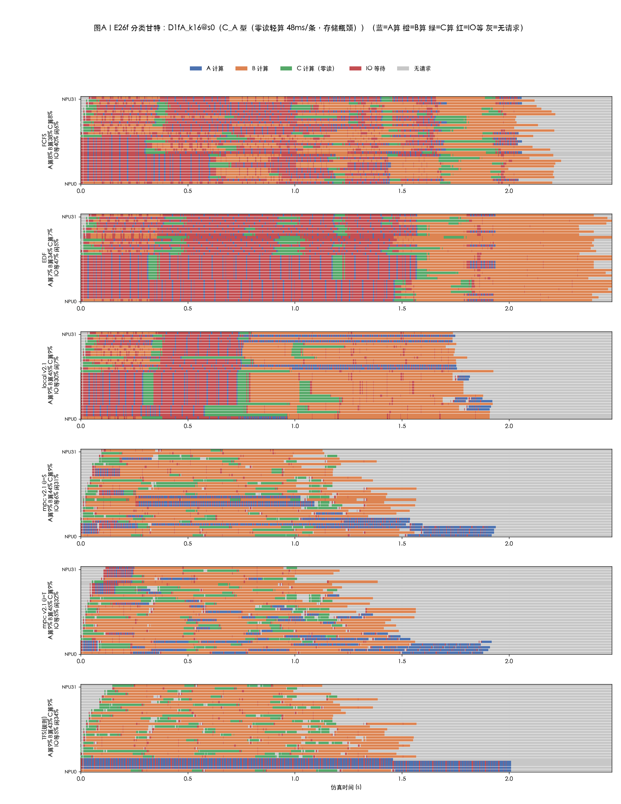

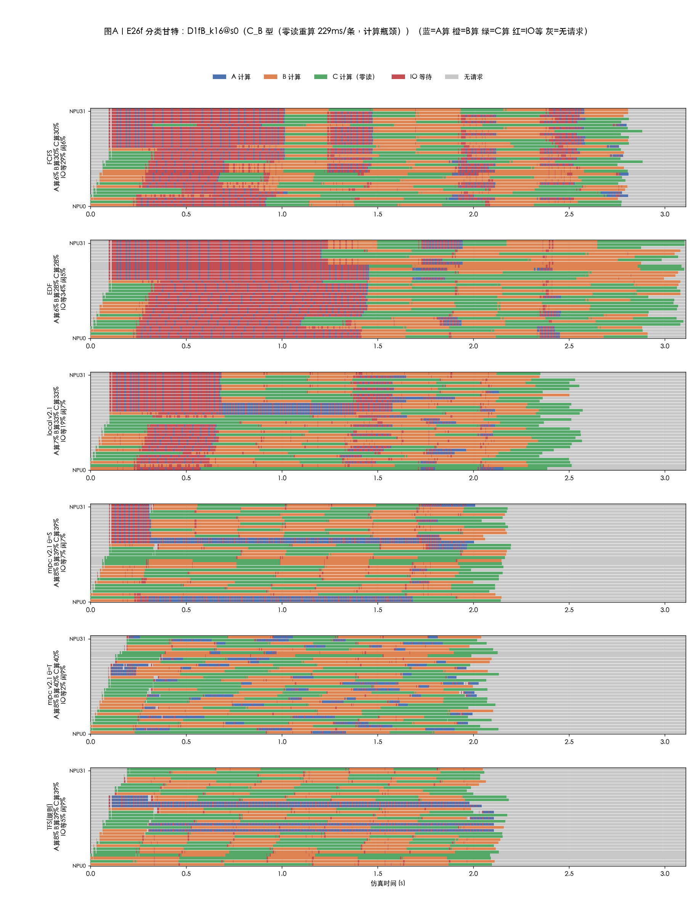

**甘特读法**（cB）：mpc θ=T 的 IO 等待占比 2.4%（与单池 1.8% 几乎持平），而 fcfs 臂 28.7%——盘维度下错峰臂仍把读取与计算重叠到近乎无损，存储变慢的代价几乎全部落在不会排队的臂上；（cA@s0 同型：mpc/tfs IO 等 5~6% vs fcfs 39.9%，且 mpc/tfs 提前收工进入闲置 31.5%，makespan 1.92s vs fcfs 2.24s）。

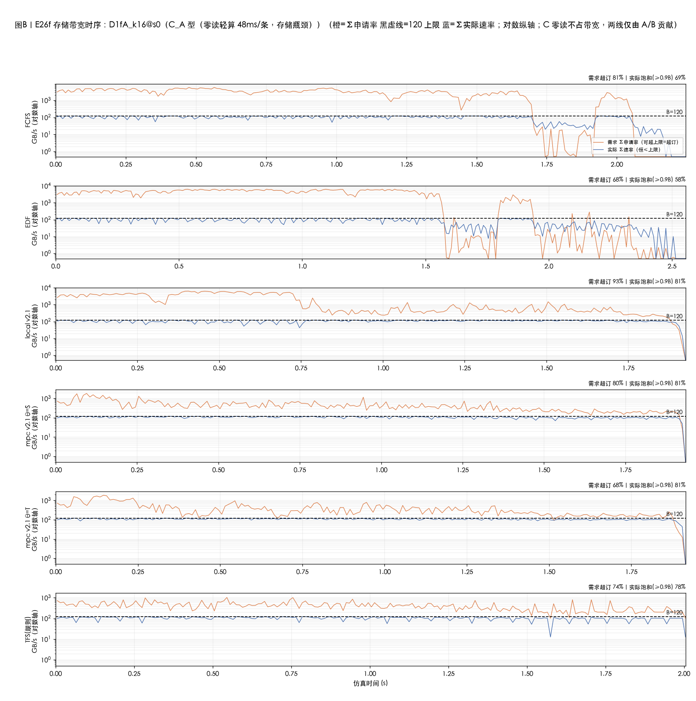

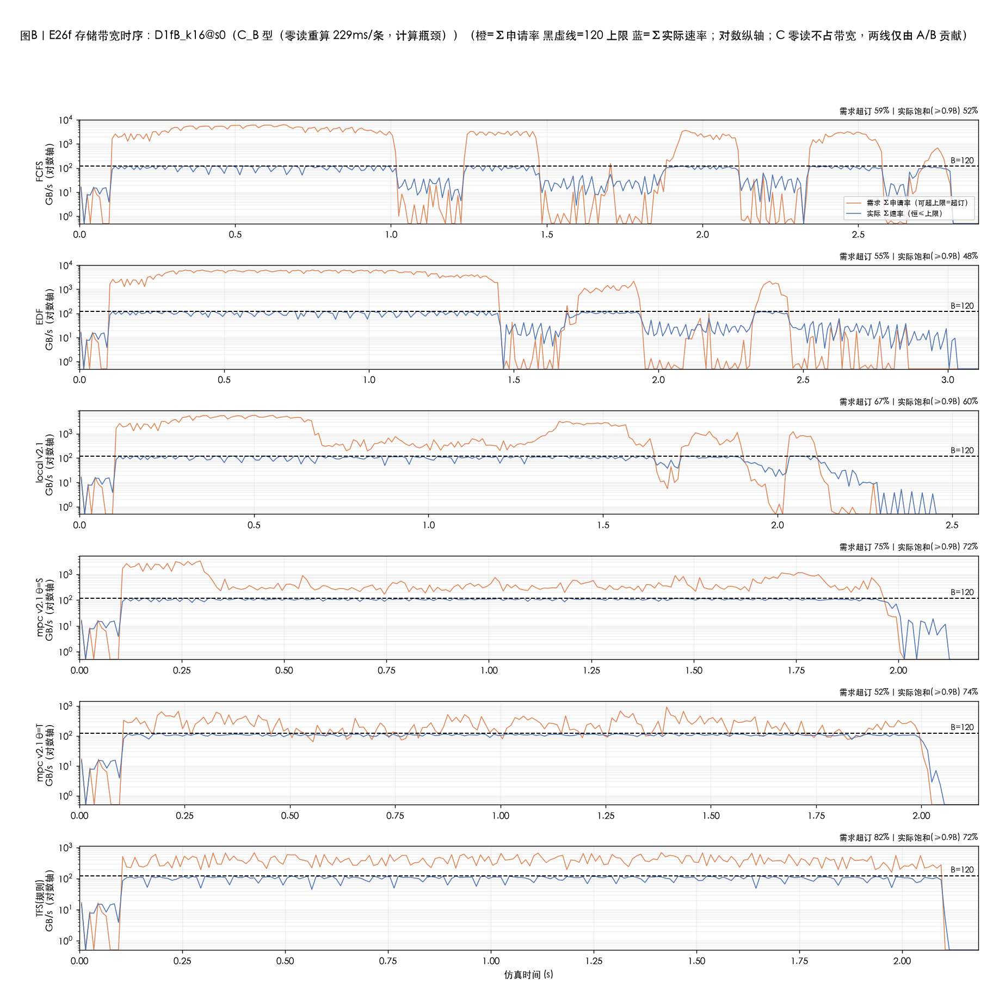

**带宽图读法**：Σ实际速率的包络整体低于单池臂（功守恒损耗，见 §4-H3）；需求超订形态不变。

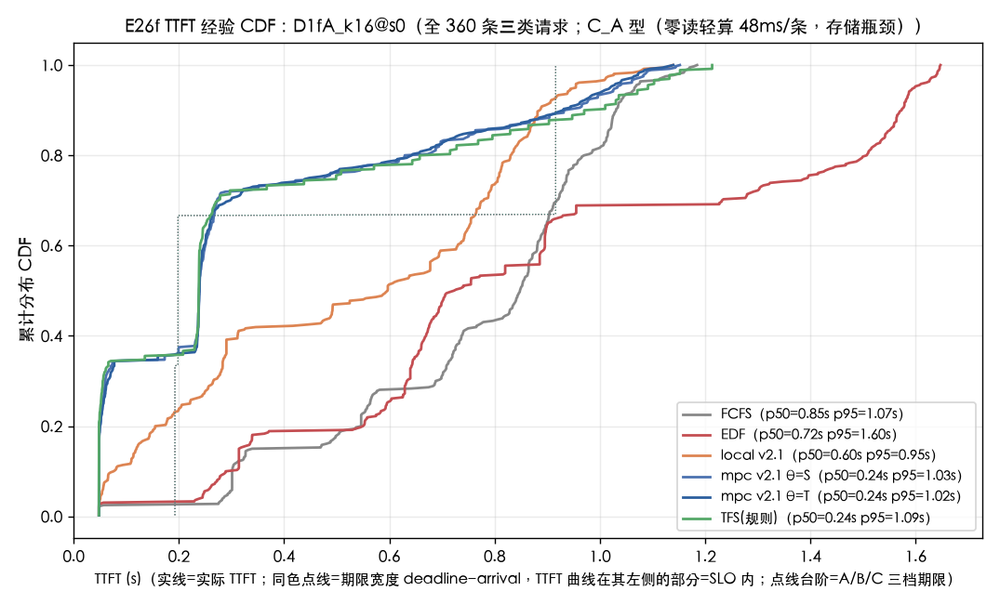

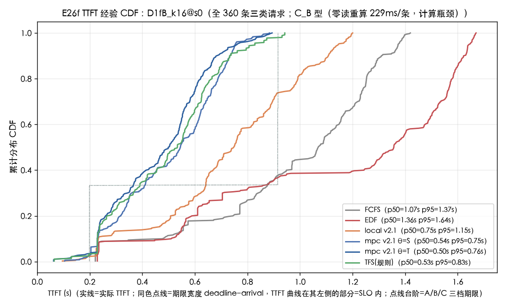

**CDF 读法**：三类期限台阶不变；盘维度下 mpc/tfs 曲线整体右移但仍在 B/C 台阶内，A 段溢出台阶更多（A-SLO 下滑的直观形态）。

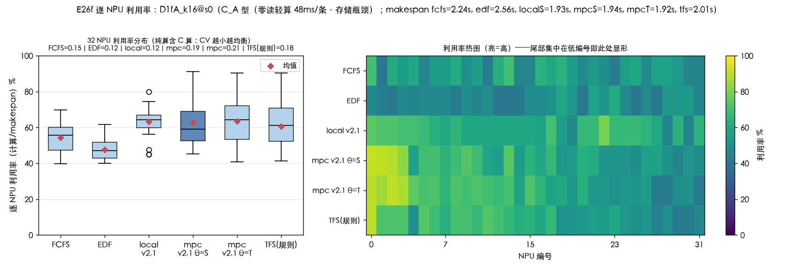

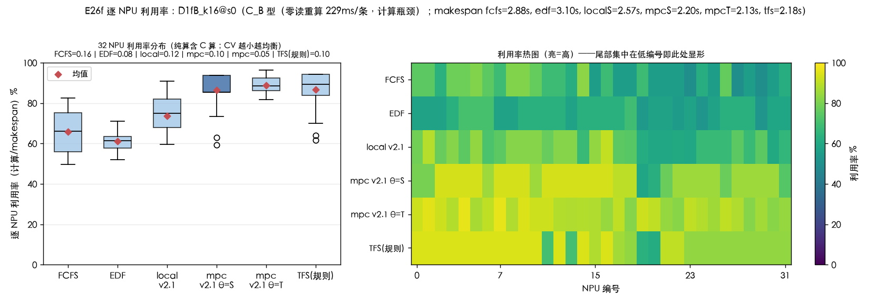

**util 读法**（cB）：mpcT 纯算均值 89%、CV 0.05（32 NPU 近乎满载均衡）；错峰臂与单池形态一致。

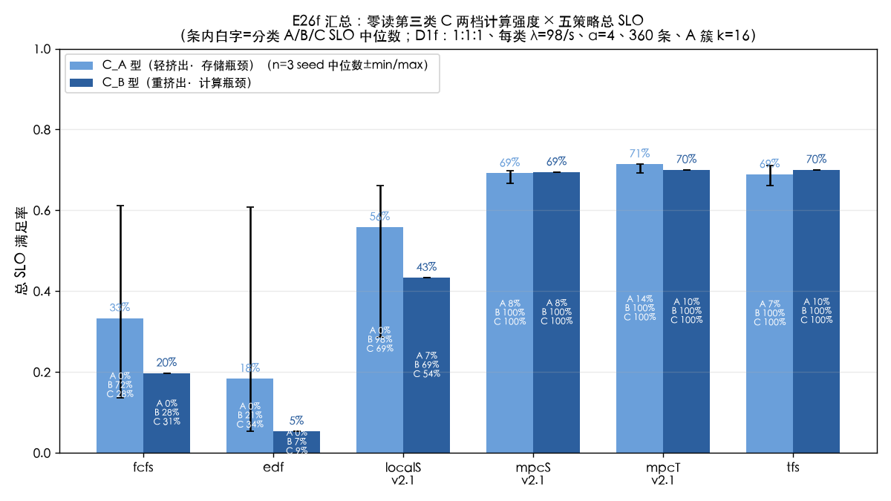

**bar 读法**：两格点条形并排 = 挤出轻/重对照；盘维度下 cA/cB 的 mpc/tfs 条仍显著高于其余臂。

## 3. 每盘带宽利用率（新增两图）

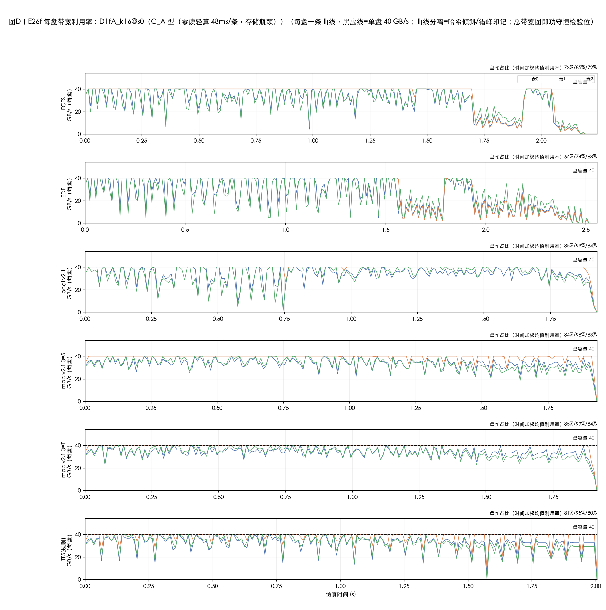

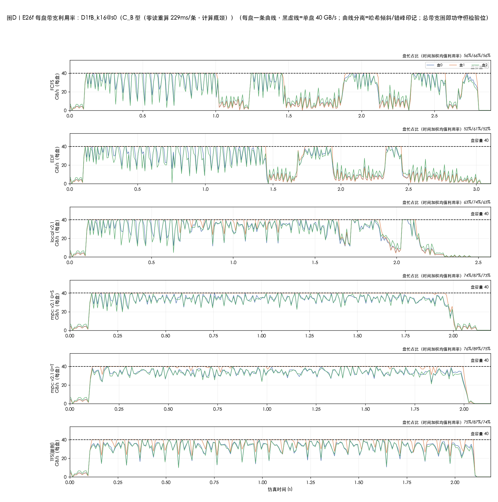

**读法**：行=6 臂，行内 3 条曲线=3 块盘的速率（10ms 分箱），黑虚线=单盘 40 GB/s。两个可读签名：
1. **倾斜签名**：曲线分层——盘 1 恒为最热（A 的 33/84 块与 B 的 8/19 块都最多落在盘 1，逐盘时间加权利用率中位数 72.6/84.7/71.8%），且**单请求末段出现"最慢盘贴 40、余盘≈闲"**（cA@s0 fcfs 前 200 区段中 40 个区段为此形态）——这是 B 类长尾与功守恒损耗的共同来源；
2. **错峰签名**：mpc/tfs 臂的盘曲线台阶比 fcfs 臂更交错（派发错开 → 盘忙期错开），盘间 CV（fcfs 臂中位 0.214）在 tfs 臂略降至 0.203——错峰对盘间不均有轻度平滑作用但不消除（倾斜是类常量，策略不感知盘）。

## 4. H1~H5 判定

### H1 稳健性 —— **基本成立（排序逐位保持；cA 差距超 +5pp 带上界，超出在"收益更大"侧）**

| 分配 | cA 臂排序 | cA mpcS−fcfs | cB mpcS−fcfs |
|---|---|---|---|
| 母（FCFS 分配） | mpcS > mpcT > TFS > local > FCFS > EDF | +29.4pp | +44.7pp |
| 单池 max_min | mpcT > mpcS > TFS > local > FCFS > EDF | +28.1pp | +45.3pp |
| 盘维度 | mpcT > mpcS > TFS > local > FCFS > EDF | **+35.8pp** | **+49.7pp** |

cA 盘维度排序与单池**逐位相同**（mpcT > mpcS > TFS > local > fcfs > edf）；mpcS−fcfs 差距 cB +4.4pp（带内）、cA +7.7pp（超带上界 2.7pp，方向为收益扩大）。cB 的前三名互有紧邻换位（mpcT ≈ TFS > mpcS，差距 <1pp）不改变集群结构。判定：H1 的"排序与差距保持"成立，"±5pp 内"在 cA 被收益扩大突破——如实记录为**部分成立（方向验证、幅度超上界）**。

### H2 长尾类签名 —— **成立（咬在 B 的尾部与弱臂 SLO 边界；mpc 臂 B-SLO 中位数守住 100%）**

| 口径（cA，mpcS 臂中位） | B ttft_mean | B ttft_p95 | A ttft_mean | A ttft_p95 | B-SLO |
|---|---|---|---|---|---|
| 母 | 0.317s | 0.543 | 0.440 | 0.799 | 100% |
| 单池 | 0.307s | 0.533 | 0.442 | 0.798 | 100% |
| 盘维度 | **0.341s (+11%)** | **0.608 (+14%)** | 0.529 (+20%) | 0.943 (+18%) | 100%（中位） |

B（19 块/层，最慢盘占比 0.436）尾部变长 +14%；更重的伤害在无错峰臂：fcfs 臂 B-SLO 中位从 96.7% → **71.7%**（三 rep 为 100/71.7/33.3——单池下三 rep 全在 90%+），local 臂 rep 级最低 21.7%。预注册的"mpc 臂 95~100%"兑现（B 中位 100%、rep 级最低仍 100%）；"fcfs 变化小"预判**过于乐观**（B 的满格余量在无错峰时被长尾啃穿）。A 的 mean/p95 涨幅（+20%/+18%）大于 B，但其 SLO 本就贴死线（A-SLO 7.5~19.2%），涨幅主要反映积压恶化而非倾斜的直接代价——A 的"几乎不变"预判在 SLO 口径成立（7.5% vs 单池 10.0%，±2.5pp）、在 TTFT 口径不成立，如实披露。C 类零块不受影响（C-SLO 形态不变）✓。

### H3 盘间不均与功守恒 —— **分离可见成立；功守恒超差（−7.3pp > 5pp 预算）**

| 口径（cA，fcfs 臂中位） | 母 | 单池 | 盘维度 |
|---|---|---|---|
| 总带宽利用率 | 83.6% | 83.7% | **76.4%** |
| 带宽饱和占比 | 79.7% | 83.7% | 69.1% |
| 逐盘利用率（d0/d1/d2） | — | — | 72.6/84.7/71.8% |
| 盘间 CV（时间加权均值） | — | — | 0.214 |
| CV>0.15 时间占比 | — | — | 17.3% |

盘间曲线显著分离 ✓（CV 0.21，超 0.15 的时间占 17.3%）；**总带宽利用率与单池差 −7.3pp，超出预注册的 <5pp**——机制：单请求末段只剩最慢盘组在读（其余盘闲置）+ 深队列下在途流数量受 worker 数限制，盘填充不满。这是"倾斜只伤延迟不伤吞吐"这一隐含预期的否定，量级为一阶。错峰臂的盘曲线台阶更交错 ✓（mpc/tfs 逐盘利用率更高：cB tfs 臂总利用率 78.4% vs fcfs 59.4%）。

### H4 推演成本 —— **成立（同口径 CPU ≈3×，fb=0）**

| 口径（cA mpcS 中位） | 单池（PAR=6 墙钟） | 盘维度（r0 为 PAR=5 墙钟，r1/r2 串行） |
|---|---|---|
| 墙钟 | 2101s | 32264s（三 rep 20763/32264/34537） |
| 决策数 | 1559 | 3132（×2.0） |
| 换算 CPU（单池×~4.8 并行度） | ≈10.1k CPU-s | ≈32.3k CPU-s |
| **CPU 比** | — | **≈3.2×**（预判 2~3× 的上缘） |

fb=0 全程（12/12 mpc/local run，健康审计全绿）✓。注意披露：预算共享语义下盘模式单次推演事件 ×2，每决策可完整评分的候选数约减半（n_overrun 32~1244 次/rep），这是固定事件预算（20000）的内生代价，本次刻意不改（唯一变量=alloc）。

### H5 逐块公平签名 —— **成立（代理口径）**

B 的层读在盘维度下不再"小而快"：mpc 臂 B p95 +14%、fcfs 臂 B-SLO −25pp（96.7→71.7 中位）——B 的小批量读与 A 的大批量读在同盘被逐块 waterfill 拉平（每块同需求上限），B 失去单池下"快进快出"的优先性；C（零块）形态不变作对照。逐层读时间未直接记录（层粒度账本保持流级），此为 TTFT/SLO 代理判定，局限如实声明。

## 5. 与前序结论的衔接

- **母实验（FCFS 分配）**：零读第三类的挤出/填空结构、A 的期限挤压死因——在盘维度下全部复现且加重（A 类在弱臂清零）。
- **单池 max_min 重跑**："max_min 替换不改变调度结论方向"——盘维度进一步确认：存储层物理保真度的提升不翻转调度层结论，反而放大调度的相对收益（mpcS−fcfs 差距两个格点都扩大）。
- **TFS 捕获率**（单池：cA 91.8% / cB 95.2%，以 mpcT 收益为分母）——盘维度下 cA 捕获 (68.9−33.3)/(71.4−33.3) = **93.4%**、cB (70.0−19.7)/(70.0−19.7) = **100%**（TFS 与 mpcT 并列 70.0）。"规则式调度捕获 MPC 大部分收益"保持且略有增强；TFS 计算时间仍低 3 个数量级（毫秒级 vs 小时级）。
- **E26f 系列累计**：存储轨道三臂（FCFS 分配 → 单池 max_min → 盘维度）形成完整阶梯：分配规则换挡（FCFS→max_min）几乎不动结论，物理保真度升挡（单池→盘）下移绝对值但不翻方向。

## 6. 局限（如实记录）

1. **无跨盘再平衡**：块钉死哈希落点，倾斜只能被承受——这正是测量对象；盘感知调度（把盘倾斜放进 quote）是后续独立课题（H3 的 −7.3pp 与 H2 的 B 长尾是立项依据）。
2. **同类共享计划**：E26f 合成负载每类一个 h → 倾斜是类常量（A 恒 0.391、B 恒 0.436），不是请求级随机；trace 负载（Mooncake/AgentX，块分布有真实散布）下倾斜形态会不同，结论不可直接外推。
3. **策略不感知盘**（设计 §3 刻意）：本实验把"物理保真度"与"盘感知调度"解耦；倾斜损失是策略盲区的量化，不是策略能力的上限。
4. **B(t) 平摊到盘**：不建模背景流量落盘。
5. **H5 为 TTFT 代理判定**：逐层读时间未入账本（流级口径保持）。
6. **执行事件**：全量首夜按设计跑两路 MPC_PAR=3，实测 fork 并行在盘模型下**负收益**（比串行慢 ~2.2×：逐候选全预算评估的浪费被"单推演事件 ×2"放大，加 fork 开销），改按 (cell, rep, arm) 串行分片 8 进程并发重跑；夜半机器断电重启杀掉 cA rep0 的 mpcS/mpcT 两臂（其余 14 分片 records 完好），断点续跑补齐。本臂结论不受影响（fb=0 审计覆盖全部 12 个 mpc/local run），但 cA rep0 两臂的墙钟为重跑口径（MPC_PAR=5），H4 表中用 rep 中位数规避该口径差。

## 7. 通俗版解读

把存储层想成**食堂打饭**：过去两轮实验里，三个打饭窗口（120 GB/s）被抽象成一个大窗口；这一轮把窗口还原成真的三个，而且每道菜（KV 块）按固定规则只在一个窗口供应。

- **一句话总结**：窗口变真实之后，会排队的调度（MPC/TFS）反而更值钱了——不会排队的（FCFS/EDF）每个窗口都吃亏，会排队的几乎没掉分。
- **Q1 稳健性**：五臂名次基本没变，MPC 比 FCFS 多救活的人还多了几个百分点。
- **Q2 长尾**：小份菜（B 类，19 块）运气不好全押在最挤的窗口，会排队的食堂能顶住（B 全达标），不会排队的食堂三成菜超时；大份菜（A 类，84 块）摊到三个窗口，尾部只多等一成半。
- **Q3 盘间不均**：中间那个窗口永远最忙（利用率 85% vs 72%）；而且每个人打饭的最后几勺只能在"他自己的菜所在的窗口"打——两个窗口干看着，总吞吐实打实掉了 7 个百分点。
- **Q4 成本**：MPC 推演要模拟三个窗口的排队，算力成本涨到约 3 倍，但没出任何错（零回退）。
- **Q5 公平**：以前小份菜能"见缝插针快进快出"，现在每个饭勺都一样大，小份菜也得跟大份菜排同一队——快进快出没有了。
- **下一步的钩子**：调度器现在看不见"哪个窗口挤"。让报价里带上窗口拥挤度（盘感知调度），那 7 个百分点和 B 类的三成长尾，就是新实验的靶子。
