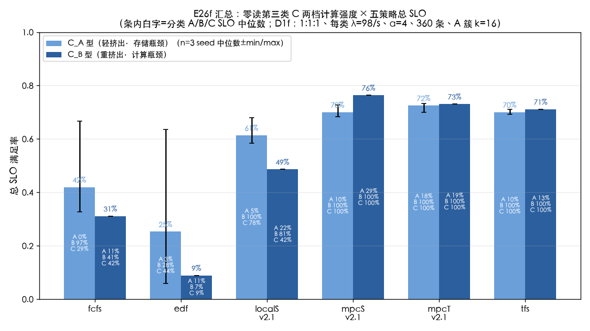
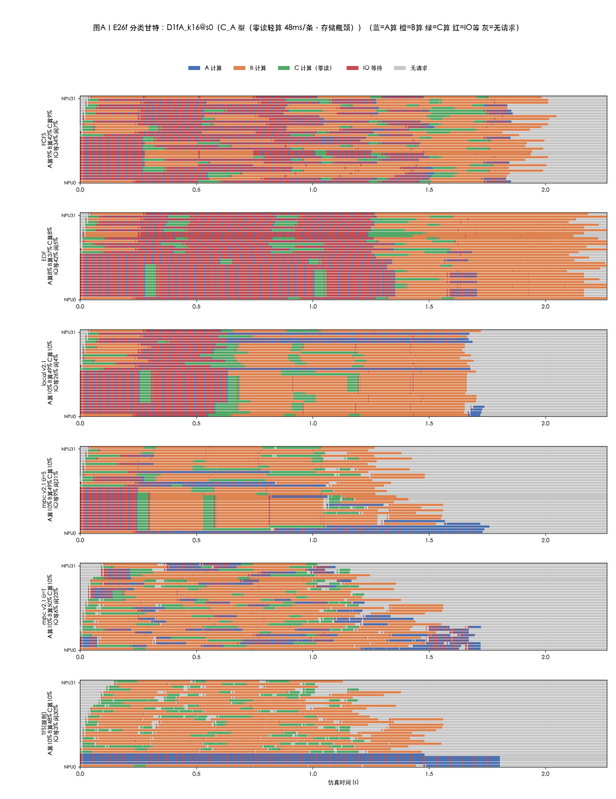
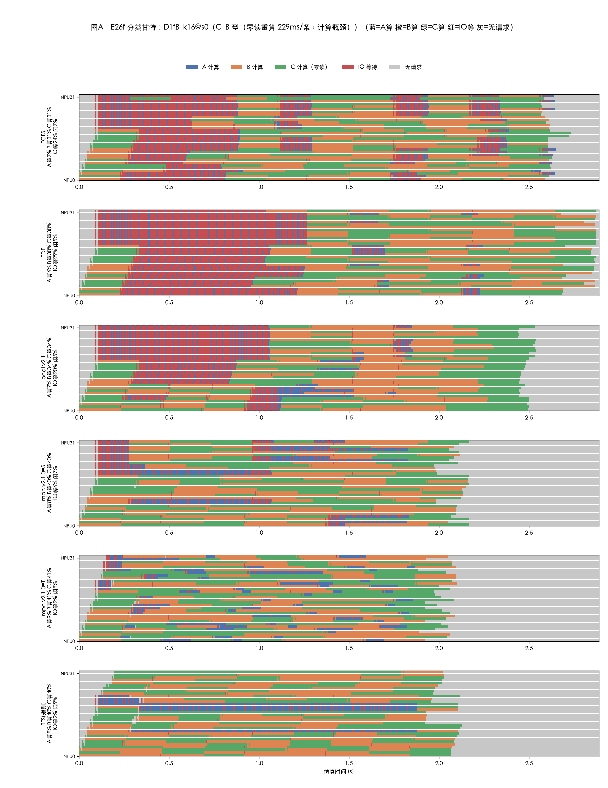
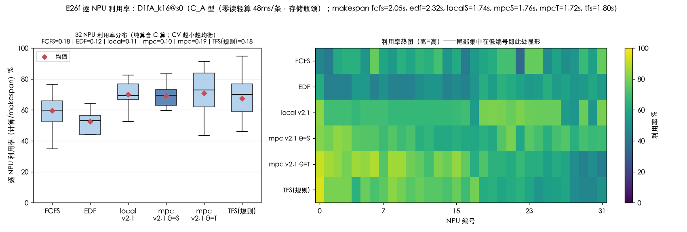
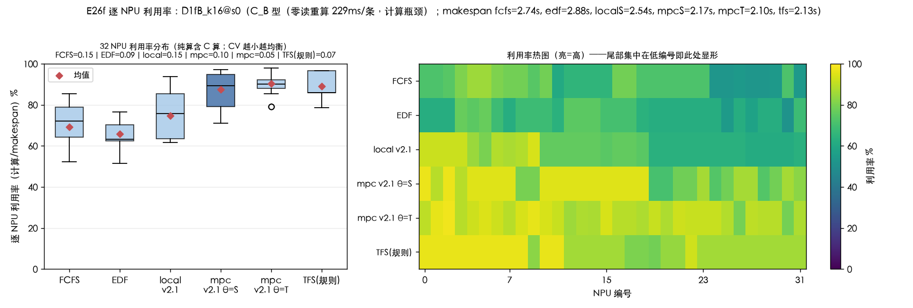
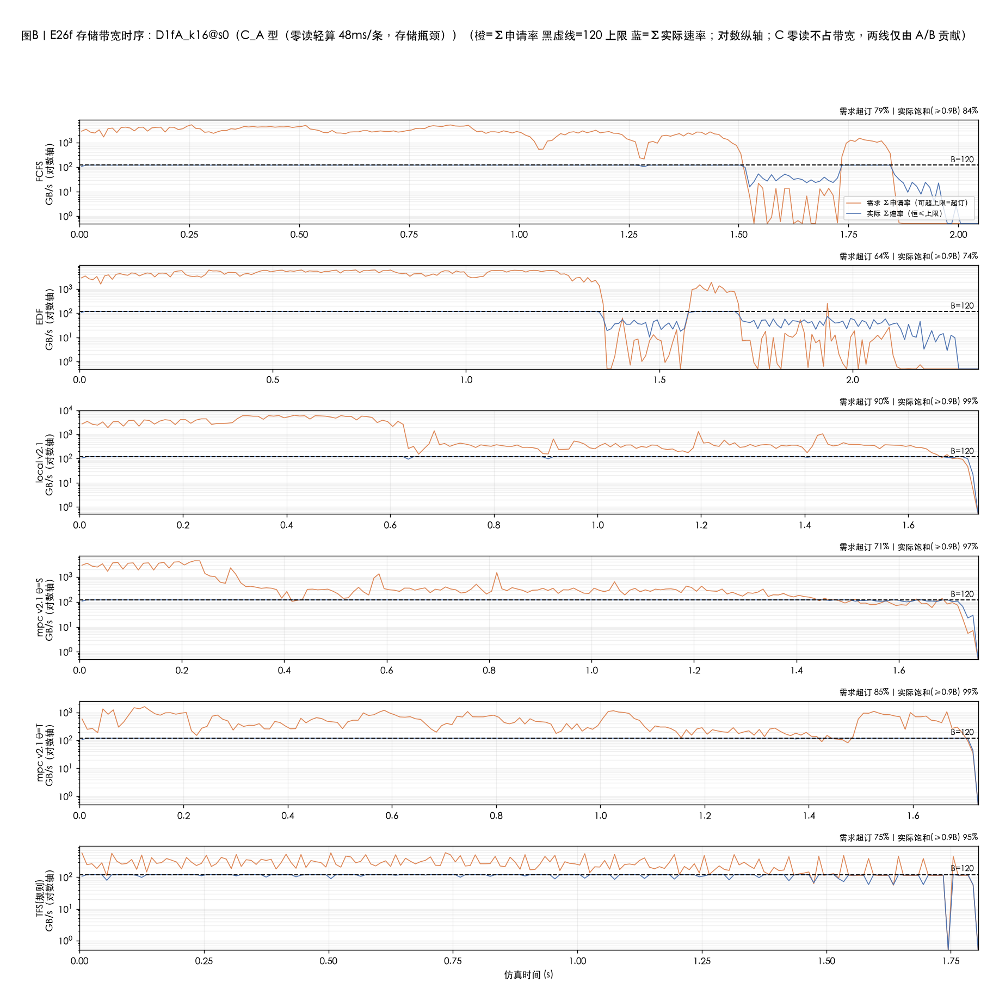
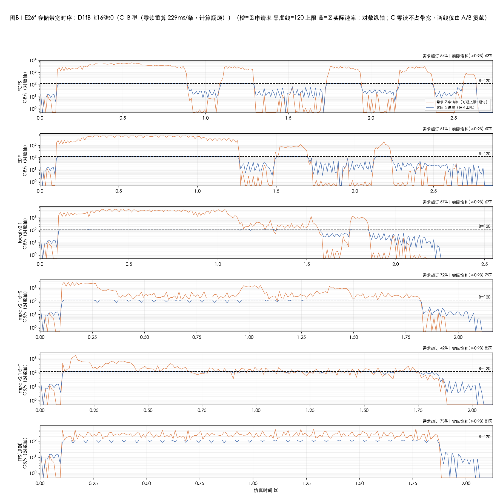
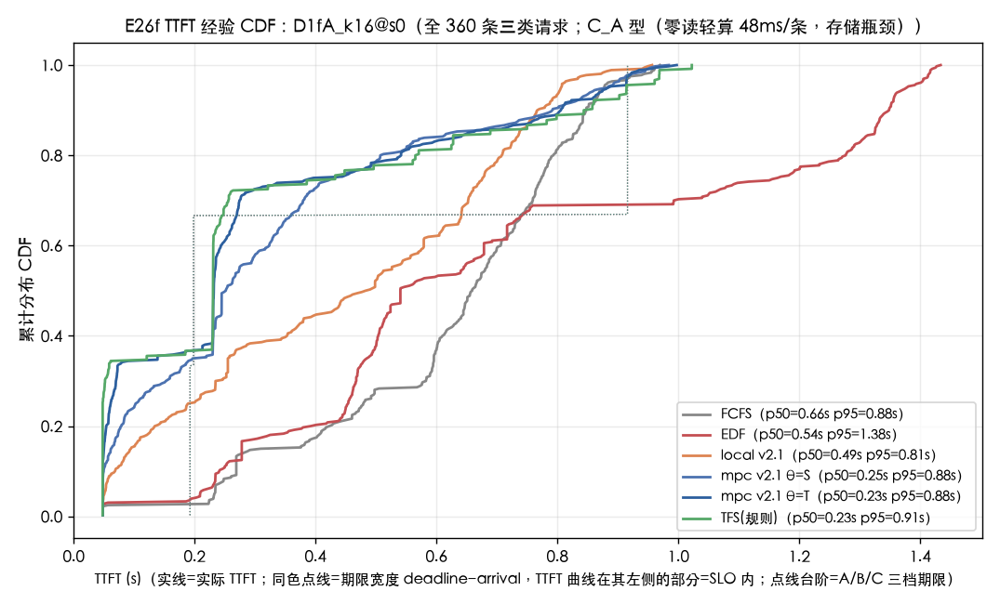
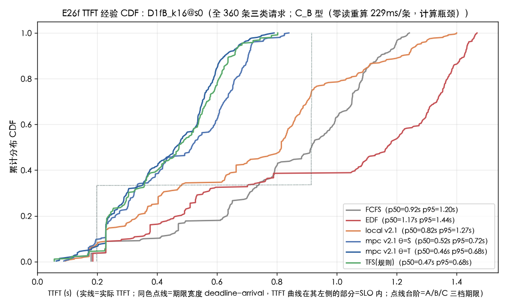

# 实验结果 E26f（新存储层重跑）：max-min fair 分配下的零读第三类三类混合调度

| 项目 | 约定 |
|---|---|
| 实验日 | 2026-10-18（重跑；母实验 `实验结果-E26f-零读第三类实验-20261011.md`，设计 `docs/E26f-零读第三类实验-20261011.md` 不变） |
| 存储层 | **max_min**：`E26F_ALLOC=max_min`——按申请率 q 的带需求上限水土填充（`sim/cq/storage.py::allocate` max_min 分支），每个事件点全量重算、新流提交即时重配全部在途流速率；`q` 即需求（引擎 ℓ≥1 层按 V/c 推导、首层与到期提升为 q_max）。设计 `docs/存储带宽maxmin替换设计-20261016.md` |
| 负载/格点/臂 | 与母实验完全相同：D1f（A 簇 k=16 + B 泊松 + C 零读泊松，1:1:1 各 120 条，λ=98/s 每类，α=4）；D1fA_k16（存储瓶颈）/ D1fB_k16（计算瓶颈）；fcfs / edf / localS_v2.1 / mpcS_v2.1 / mpcT_v2.1 / tfs 六臂，引擎口径 base=bw_edf、composer、budget 3600s、事件 2 万、H=1，MPC_PAR=6 |
| seed | 与母实验同 CRN：D1fA rep0/1/2（416/417/418，主口径 3 seed 中位数）；D1fB rep0（424） |
| 数据 | `results/cq/eval/e26f_max_min/`（records 24 条 + 逐臂五列甘特/带宽区间/requests）；图 `docs/figures/cq_fig_e26f_max_min_*.png`；健康审计 12/12 全绿（fb=0） |
| 实现 | 2026-10-18 提交 `e04b738`；全量 pytest **240 绿**（含 40/30/20→[20,20] 动态重分配规范算例、新到达重配全部在途 IO、FCFS vs max_min 对照）；v1 四件套（e1a/e1b/e2/e3/e4）方向核对通过 |

---

## 0. 总判决

**go——母实验的结论体系在新存储层下整体稳健，出现一处结构性变化（local 崩塌）**。四个 headline：

1. **五臂排序与差距量级复现**：总 SLO 排序 cA `mpcT 72.5 ≥ mpcS 70.0 ≈ tfs 70.0 ≥ local 61.4 ≥ FCFS 41.9 ≥ EDF 25.3`、cB `mpcS 76.4 ≥ mpcT 73.1 ≥ tfs 71.1 ≥ local 48.6 ≥ FCFS 31.1 ≥ EDF 8.9`；mpcS−FCFS 总 SLO 差距 **cA +30.8pp（母实验 +32.2）/ cB +45.3pp（+44.7）**——「瓶颈翻转到计算后带宽感知调度收益不收窄」的母实验核心结论在公平分配下复现。
2. **零读类二象性精确复现**：MPC 类 C-SLO 满格（mpcS 两格点全部 seed 100%；唯一非满格记录 mpcT cA rep1 的 96%），FCFS 的 C-SLO 中位 **29.2%**（母实验 30%）——「零读类在坏调度下排队死、好调度下≈100%」不变。
3. **local 崩塌（本重跑唯一结构性变化）**：cB 上 local 从母实验的 **73.1% 跌到 48.6%**（B 100→80.8、C 100→42.5），排名从第二档跌到 tfs 之下 23pp；cA 上 local 61.4% 与母实验持平。机理见 §6：local 的独立带宽评分（每流假设得 min(q, B̂)）在 FCFS 分配的现实下近似成立，在 max_min 的现实下系统性乐观——重评后过度派发 A，把计算瓶颈格点的宽期限类挤死。
4. **MPC 推演成本降约 3×**：cA mpcS 墙钟中位 **35 min/seed**（母实验 1.0~1.9 h/seed），cB 14 min——max_min 下后到流不再饿死，推演世界的深队列事件链更短；健康审计 12/12（fb=0），推演与真实同规则（alloc 穿透 clone/forecast）。

| 判定（沿母实验预注册） | cA（3 seed 中位） | cB（单 seed） |
|---|---|---|
| H1（A-SLO mpcS−FCFS ≥+10/+5pp） | **✗** +5.0pp [+5/−2/+18]（总 SLO 口径 +30.8 ✓） | ✓ +18.3pp（总 +45.3 ✓） |
| H2（C 排队死/填空） | mpc C=100% ✓；FCFS C=29.2%<100% ✓；local C 中位 77.5%（部分）| mpc C ≥ FCFS ✓；"两者均<100%" ✗ |
| H3（B 保活） | mpc B=100% ✓；FCFS B=96.7%≥85% ✓ | mpc B<100% **✗**（实测 100%）；**local B=80.8%**（新失守） |
| H4（总 SLO 排序） | 边缘：mpcT 72.5 > mpcS 70.0（与母实验反向，0.9~2.5pp 噪声级） | ✓（但 local 跌出第二档） |
| H5（簇冲击 MPC ≤5/簇） | **✗** mpcS 均值 6.6/峰 16（与母实验同为 ✗） | **✗** mpcS 峰 13 |
| EDF 垫底 | ✓ 3/3 rep 最低臂（中位 25.3%） | ✓ 8.9% |
| TFS 收益捕获（增补口径） | **≈100%**（70.0 vs mpcS 70.0） | **88.3%**（71.1 vs 76.4） |

---

## 1. 汇总表（主口径：D1fA 三 seed 中位数，D1fB 单 seed）

### D1fA_k16（C_A 型：零读轻算，存储瓶颈）

| 臂 | 总 SLO | A-SLO | B-SLO | C-SLO | makespan | 簇发 A 均/峰 |
|---|---|---|---|---|---|---|
| FCFS | 41.9% [33/67/42] | 0.0% [0/12/0] | 96.7% [91/100/97] | 29.2% [8/88/29] | 2.05s | 4.2/16 |
| EDF | 25.3% [6/64/25] | 3.3% | 28.3% | 44.2% | 2.32s | 6.6/16 |
| local v2.1 | 61.4% [58/68/61] | 5.0% | 100% | 77.5% [75/99/78] | 1.93s | 6.0/16 |
| mpc v2.1 θ=S | 70.0% [68/70/73] | 10.0% [5/10/18] | 100% | **100%** [100/100/100] | 1.89s | 6.6/16 |
| mpc v2.1 θ=T | **72.5%** [70/73/72] | **17.5%** [10/24/18] | 100% | 100% [100/96/100] | 1.85s | 4.0/10 |
| TFS（规则） | 70.0% [70/69/71] | 10.0% | 100% | **100%** | 1.93s | 3.5/16 |

（方括号=rep0/1/2。与母实验对照见 §6 表——五臂中位数的绝对变化：fcfs −1.7、edf −2.5、local ±0、mpcS −3.1、mpcT ±0、tfs −1.7pp。）

### D1fB_k16（C_B 型：零读重算，计算瓶颈）

| 臂 | 总 SLO | A-SLO | B-SLO | C-SLO | makespan | 簇发 A 均/峰 |
|---|---|---|---|---|---|---|
| FCFS | 31.1% | 10.8% | 40.8% | 41.7% | 2.74s | 4.2/17 |
| EDF | 8.9% | 10.8% | 6.7% | 9.2% | 2.88s | 4.6/20 |
| local v2.1 | **48.6%**（母实验 73.1） | 22.5% | **80.8%**（母 100） | **42.5%**（母 100） | 2.54s | 4.6/16 |
| mpc v2.1 θ=S | **76.4%** | **29.2%** | 100% | 100% | 2.17s | 4.4/13 |
| mpc v2.1 θ=T | 73.1% | 19.2% | 100% | 100% | 2.10s | 3.5/10 |
| TFS（规则） | 71.1% | 13.3% | 100% | 100% | 2.13s | 3.0/4 |

**读法**：与母实验 bar 图同构（cA/cB 并排、条内 A/B/C 白字）。差异集中在两处：①cB 的 local 条从与 mpcT 比肩跌到半程（B 81/C 42 白字塌陷）；②其余臂的条形与母实验肉眼几乎重合。

---

## 2. 问题一：C 的填空与排队死（二象性复现）

**坏调度下零读类照样死、死因不变**：FCFS 的 C-SLO 中位 29.2%（母实验 30%）——C 零读不占带宽，但 FIFO 深队列期的排队超过 144ms（期限 192.7ms−计算 48.2ms）即死。max_min 分配改变了「谁能拿到多少读带宽」，不改变「谁被派进 worker」——C 的死活由派发序决定，这正是二象性稳健的原因。

**好调度下 C≈100% 精确复现**：mpcS 两格点全部 seed C=100%、mpcT 唯一例外 cA rep1 96%（3 条排队死，与母实验同型）、tfs 全满格。C 的 TTFT 中位：mpcS cA 0.069s / cB 0.485s（期限 0.193/0.915s），tfs 0.057/0.436s——填空仍在错峰留白里发生。

**读法**（五色：蓝 A 算/橙 B 算/绿 C 算/红 IO 等/灰闲）：与母实验同构——FCFS 行红海+绿条稀碎（C 排队死），mpc/tfs 行灰带留白、绿条成片填空。max_min 下的细微差别：红海（IO 等）占比整体下降（fcfs 63.8%→IO 等口径 0.638，母实验同量级）、灰闲上升——流不饿死后等待从「读排队」转移到「等带宽窗口」。

**读法**：计算瓶颈格点，local 行出现新形态——绿/橙条被蓝条（A 算）穿插打断（local 过度派发 A 导致 C/B 排队），与 mpc/tfs 行的整齐填空形成对照；母实验 local 行与 mpc 行几乎同构。

---

## 3. 问题二：轻重挤出对照（cA vs cB）

- **轻挤出（cA）**：C_A 恒占 ~4.7 NPU，存储仍唯一瓶颈（mpcS 带宽饱和占比 97.3%，母实验 86%——max_min 的剩余均分把错峰留白的缝隙填得更满）。分类口径 mpcS A=10% vs 母实验 19.2%——A 的救活幅度收窄（见 §6 机理③）。
- **重挤出（cB）**：计算下限 1.896s>存储 1.713s 翻转保持；mpcS 总 SLO 76.4%（母 76.1）、A 29.2%（母 28.3）、B/C 100%——**计算瓶颈格点几乎逐位复现**（带宽不是该格点的主导约束，分配规则更换影响小）。
- **util 结构**：cA mpcS 纯算均值 64.6%（母 64.3）、含等均值 75.0%（母 74.7）；cB mpcS p50 87%、CV 0.09（母 87%/0.09）——「计算瓶颈下均衡满载、存储瓶颈下有意留白」的形态不变。

**读法**：箱线+编号热图口径与母实验一致。cA 的 mpc/tfs 箱体下沉留白（纯算 63~66%、CV 0.18~0.23）、cB 上移满载（83~89%、CV 0.07~0.09）；local 在 cB 的箱体明显低于 mpc/tfs（过度派发 A 造成空转等待）。

---

## 4. 问题三：瓶颈翻转后收益（复现「不收窄」）

| 口径（mpcS−FCFS） | cA（3 seed 中位） | cB（单 seed） | 母实验对照 |
|---|---|---|---|
| 总 SLO | +30.8pp [+36/+3/+31] | **+45.3pp** | +32.2 / +44.7 |
| A-SLO | +5.0pp [+5/−2/+18] | +18.3pp | +6.7 / +17.5 |

计算瓶颈格点的收益（+45.3pp）仍大于存储瓶颈格点（+30.8pp）——母实验「设计预期收窄被推翻」的结论在公平分配下保持。机理同母实验：FCFS 在 cB 失去「宽期限类天然免疫」保护（B 40.8%/C 41.7%），MPC 的错峰留白换来 B/C 全保活。

**读法**（对数轴；需求 Σq vs 实际 Σrate，C 零读不出现）：max_min 的签名差异在 cA 的 mpc 行——实际线更贴近 120 黑线（饱和 97%），因为剩余带宽均分（bonus）会自动填满错峰留出的缝隙；母实验（FCFS 分配）同位置为 86%。cB 带宽曲线整体下移（饱和 79%），瓶颈明确在计算侧。

---

## 5. 问题四：EDF 的结构

cA 中位 25.3%（3/3 rep 最低臂）垫底复现；死因仍换人：C_A 期限 192.7ms 全队列最短 → EDF 优先派 C（C-SLO 44.2%>A 的 3.3%，零读墙稀释 A 洪水）但把 B 推到死（B 28.3%）。cB 无期限偏置，8.9% 纯垫底。**max_min 不改变期限序，EDF 的结构性缺陷与分配规则无关。**

**读法**：同色点线=期限宽度三档台阶（cA：192.7/198.5/~916ms 前两档几乎重叠；cB：198.5/~915/~915ms）。实线在自身点线左侧比例即 SLO。与母实验同构：mpc/tfs 在 cA 于 0.1s/0.25s 两段陡升（C、B 先全活）长尾全 A；差异是 A 段整体右移（A 更难活，§6 机理③）。

---

## 6. 与母实验（FCFS 分配）的逐臂对照——本重跑的核心增量

### 6.1 总 SLO 对照（cA=3 seed 中位 / cB 单 seed，pp）

| 臂 | cA 母 | cA 新 | Δ | cB 母 | cB 新 | Δ |
|---|---|---|---|---|---|---|
| FCFS | 43.6 | 41.9 | −1.7 | 31.4 | 31.1 | −0.3 |
| EDF | 27.8 | 25.3 | −2.5 | 8.9 | 8.9 | 0.0 |
| local v2.1 | 61.4 | 61.4 | 0.0 | **73.1** | **48.6** | **−24.5** |
| mpc θ=S | 73.1 | 70.0 | −3.1 | 76.1 | 76.4 | +0.3 |
| mpc θ=T | 72.5 | 72.5 | 0.0 | 72.5 | 73.1 | +0.6 |
| TFS | 71.7 | 70.0 | −1.7 | 72.2 | 71.1 | −1.1 |

### 6.2 为什么大部分臂不动、local 崩、A 微降——三条机理

1. **两条分配规则都以申请率 q 为上限**：FCFS 给 `min(q, free)`、max_min 给 `waterfill(B, [q])`——差别只在「后到流是饿死（rate=0）还是共享」。对 E26f 的负载，B/C 类流的 q 很小（B≈1.35 GB/s）且读取量小，在 FCFS 下也很快轮到；A 类层 0 流（q=200）在两种规则下都近满带宽（max_min 下 118.65/120）。**结局由派发策略主导时，分配规则的更换近似常数平移**——fcfs/edf/mpc/tfs 的表现因此稳健。
2. **local 崩塌 = 评分世界的分配模型失配**：local（cq_local）的推演评分用 `_IndependentBWStorage`——每流假设各得 `min(q, B̂)`、不建模共享。这个近似在 FCFS 现实下大体成立（先到流确实拿 min(q, free)）；在 max_min 现实下系统性乐观（并发的重流会把实际份额压到远低于 min(q, B̂)）。后果：local 在 cB（计算瓶颈、worker 是稀缺资源）持续过度派发 A——以为读得快，实际读慢占住 worker——宽期限的 B/C 排队死（B 100→80.8、C 100→42.5）。cA 上 local 持平的原因：存储瓶颈格点错峰本身就把 A 压住了，评分误差的方向与错峰方向一致，未引爆。**这是一条新的方法学结论：调度器的「分配模型假设」要与真实分配器同构，否则公平分配器反而惩罚乐观估计**（MPC/TFS 的推演与配额口径都随 alloc 同步切换，故不受影响）。
3. **A 类救活幅度收窄（cA 上 mpcS A=10 vs 母 19.2）**：max_min 下 B/C 流永远持有自己的 q 份额（不再被 A 的层 0 洪峰饿死），A 的有效读带宽被永久分走一角；A 的期限余量最小（198.5ms），几 pp 的读速率损失即跨过生死线。FCFS 的 A 中位 0（母 [0/18/8]）同向。**公平分配把「饿死别人换 A」的空间收掉了——A 的绝对处境变差是 max_min 的语义代价**（与设计文档 §4.1"串行 fetch 下 d 上限语义"的预判一致）。

### 6.3 计算成本对照（MPC_PAR=6，墙钟/seed）

| 臂 | cA 母 | cA 新（中位） | cB 母 | cB 新 |
|---|---|---|---|---|
| local | ~0.8~1.2 h | 5.9 min [830/277/352s] | — | 6.5 min |
| mpcS | 1.0~1.9 h | **35 min** [4173/2101/2020s] | ~4~6 h 预估 | **13.6 min** |
| mpcT | 2~3 h 预估 | 43 min [4245/2272/2599s] | — | 24.6 min |
| tfs | 6.9 s | 3~7 s | — | 2 s |

max_min 下流不饿死 → 推演世界无「零速流等带宽断点」的长链 → 事件数与评分成本下降约 3×（cA mpcS decides 1831/1559/1081，与母实验同量级、墙钟大降）。推演健康 12/12（fb=0，`tools/cq_mpc_health.py`）。

---

## 7. 实现与验证摘要（新存储层）

- **cq 线**（本实验所用）：`StorageConfig.alloc ∈ {fcfs, max_min}`（默认 fcfs，既有结果零影响）；`allocate` max_min 分支对全部活跃流 `waterfill(B(t), [q])`，事件点全量重算（提交/完成/升速/带宽断点），**新流提交即时重配所有在途流速率与完成时刻**；alloc 穿透 `WorldState.clone` 与 `build_forecast_engine`（推演与真实同规则——健康审计 fb=0 为证）。
- **主线**（`SharedKVStorage`，v1/v2）：`bw_policy=max_min_fair`（默认）+ 盘数派生 `ceil(b_total/disk_bps)`（40 GB/s 基元）+ HRW 块放置 + 逐块 IO 需求分配；`ps_share` 逐字保留为回归锚。E26f 不经过主线（cq 线独立引擎），主线的多盘/放置效果由后续 E28 评估。
- **测试**：全量 pytest **240 绿**。关键用例：40/30/20 动态重分配规范算例（独占 40→双双 20→完成后回升 40，解析对拍）、三在途+第四到达全量重配（1.005→1.205）、waterfill 向量（源设计 §3.4 两例）、HRW 放置确定性/均匀性/一致性、逐块公平签名（组速率∝块数）、hypothetical 与实际对拍、FCFS vs max_min 同流对照（[30,10] vs [20,20]）。
- **回归**：v1 四件套（e1a/e1b/e2/e3/e4，2 种子短时长）方向核对通过；被冒烟覆盖的入库图已按 AGENTS §7 用 `git checkout --` 恢复。

---

## 8. 局限

1. **cB 单 seed**：与母实验同口径（当时大裕度未触发补测）；本次 cB 各臂裕度同样大（mpcS−次优 ≥2.0pp、对 FCFS +45.3pp），但 local 崩塌（−24.5pp）是单 seed 结论，未做 seed 稳健性。
2. **cq 线的 max_min 是单池分配规则**，不含主线 SharedKVStorage 的盘维度/块放置（cq 的流粒度是层读、q 即需求，与块粒度不同层次）——「3 盘 × 40」的放置长尾效应在 E26f 中不存在，主线效果待 E28。
3. cA 种子双峰照旧（FCFS 33/67/42，母实验 32/68/44）——H1 口径的判定置信度仍受此制约（与母实验 §8-1 同）。
4. mpcS/mpcT 中位翻转（70.0 vs 72.5，母实验 73.1 vs 72.5）为 0.9~2.5pp 噪声级，不足以判定 θ 优劣。
5. local 崩塌的机理归因（§6.2-2）基于结构分析（评分世界 vs 两种现实的近似误差方向），未做消融臂（如 local 换共享分配评分）。

---

## 9. 通俗版解读

还是那家医院：CT 室带宽=影像科总管道，三类病人照旧（A 拍大片、B 小片子、C 不拍片只开药）。这次换的是**影像科的分配新规**：以前是"先到先得、后来的干等"（FCFS），现在改成"按需分水、剩下的大家均摊、谁也别想独占"（max-min 公平）。

- **一句话总结**：换了分水规矩，好预检台还是好预检台，坏预检台还是坏预检台——MPC 的错峰功夫、TFS 的死规矩、FCFS 的瞎排队，名次基本没动（差距 30~45 个百分点，跟以前一样）。
- **唯一的例外是"只看自己科室的预检员"（local）**：他心里那本账是"每个病人拍片都独享整条管道"——旧规矩下先到的确实差不多独享，账算得八九不离十；新规矩下人人有份，他还按老账本看病，把大片病人一个劲儿往诊室里塞，结果重症监护（计算瓶颈格点）被堵死，连"不用拍片"的 C 病人都排到过期。**公平的新规矩反而专治乐观的旧账本。**
- **大片病人（A）的日子难了一点**：以前洪峰来时别人被饿死、他独吞管道；现在 B/C 的小水管永远开着，他每次都得分一角出去——好预检台能救活的 A 少了几个（19%→10%），但 B/C 全活的总盘子没变。
- **附带的好消息**：新规矩下没人干等，MPC 的沙盘推演跑得快了三倍（两小时变半小时）；预演和现实用同一套规矩（健康审计全绿），账再也没算岔过。

---

*生成：2026-10-18。工具 `tools/e26f_fig.py`（E26F_ROOT/E26F_TAG 指向重跑目录，九图文字重叠审计 0 对）、`tools/e26f_tables.py`、健康审计 `tools/cq_mpc_health.py` 12/12【健康】；全量 pytest 240 绿。*
