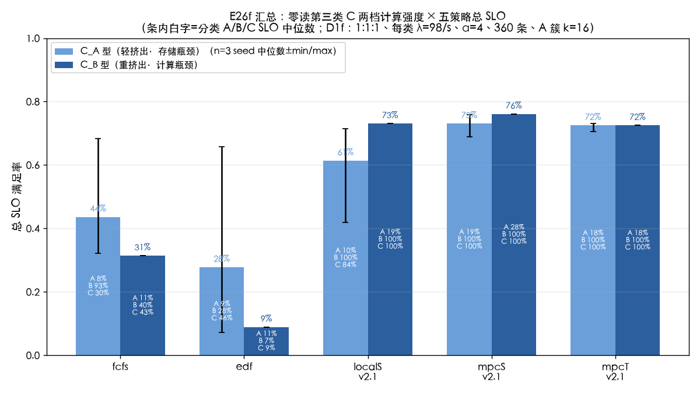
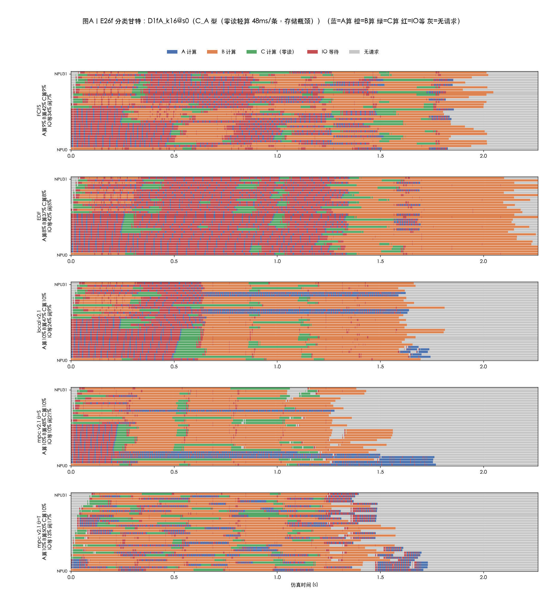
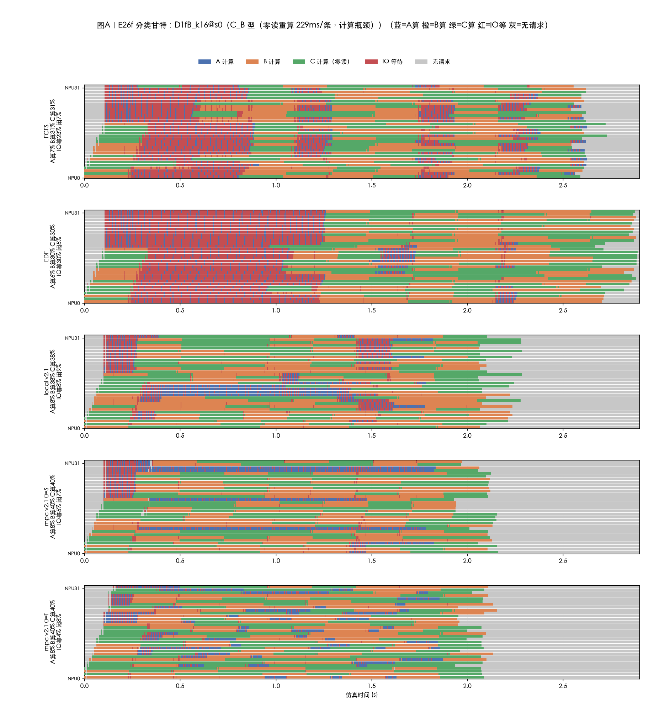
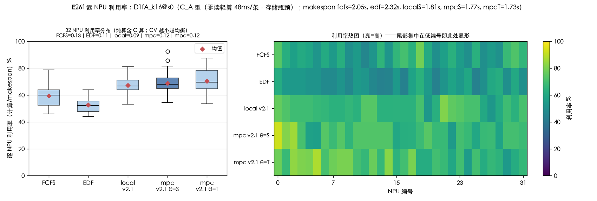
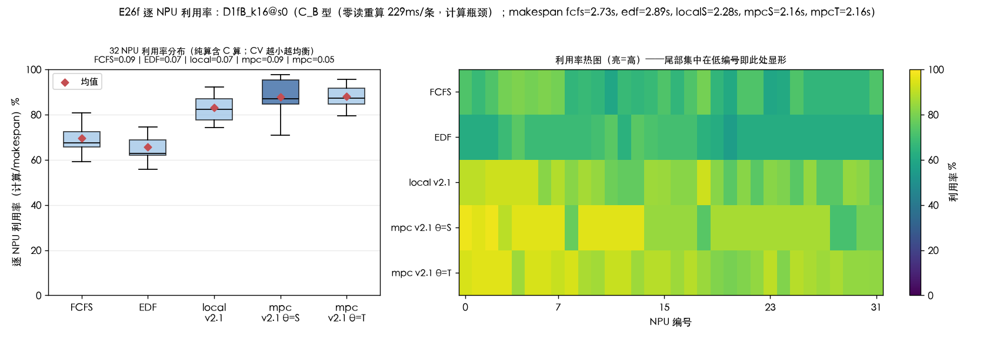
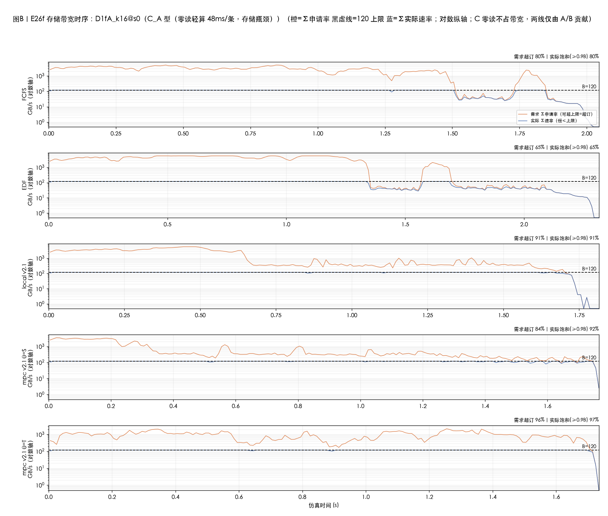
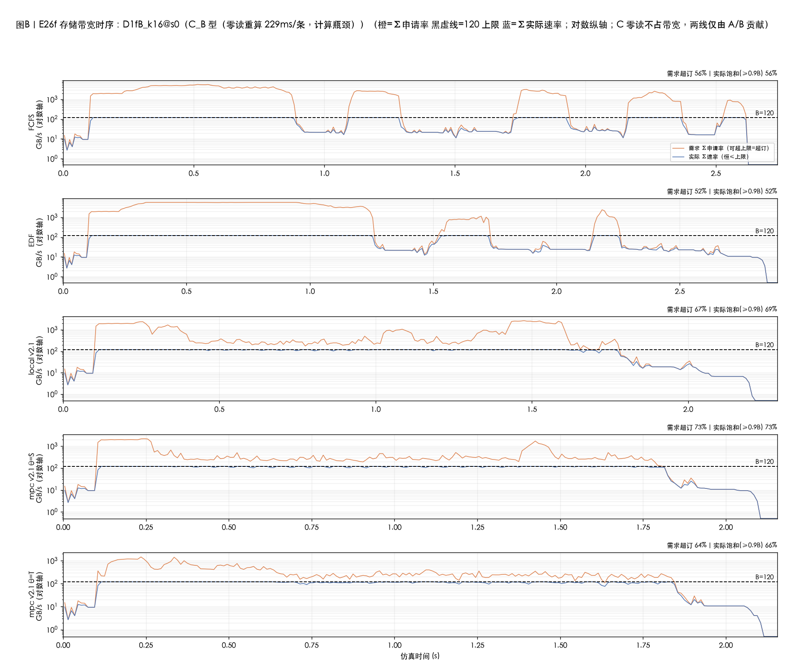
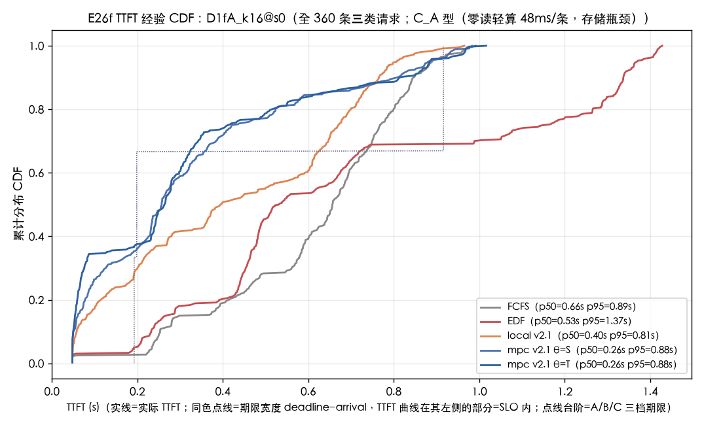
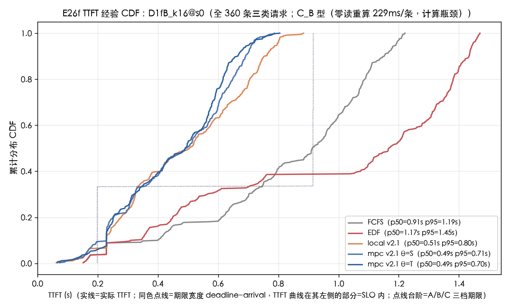

# 实验结果 E26f:零读第三类 C 请求(D1f)——三类混合下的带宽感知调度

| 项目 | 约定 |
|---|---|
| 实验日 | 2026-10-11~12(设计 `docs/E26f-零读第三类实验-20261011.md`,同日批准执行) |
| 负载 | D1f:A 簇泊松 k=16 + B 泊松 + **C 泊松(零读纯算)**,1:1:1 各 120 条共 360,每类 λ=98/s,α=4 |
| 格点 | **D1fA_k16**(C_A 型 u=2657 每层算 6.02ms=A,T0=48.17ms,期限 192.7ms——存储瓶颈)/**D1fB_k16**(C_B 型 u=8110 每层算 28.59ms=B,T0=228.7ms,期限 914.9ms——计算下限 1.896s 反超存储 1.713s) |
| 臂 | fcfs / edf / localS_v2.1 / mpcS_v2.1 / mpcT_v2.1(base=bw_edf、composer、budget 3600s、事件 2 万、H=1,全量 MPC_PAR=6) |
| seed | D1fA:416/417/418(rep0/1/2,A-SLO 口径触发补测规则取中位数);D1fB:424(单 seed,两口径均大裕度达标未触发) |
| 引擎 | **含一处引擎修复**:`build_forecast_engine` 对 V=0(零读)活动批漏置 `read_ready[ld]` → 推演永久卡死、fallback≈76%;修复后健康审计 12/12 全绿(fb=0),全量 pytest 212 绿零回归(详见 §7) |
| 数据 | `results/cq/eval/e26f/`(records 20 条 + 逐臂五列甘特/带宽区间/三类 requests);图 `docs/figures/cq_fig_e26f_*.png` |

---

## 0. 总判决

**go(条件性)**。三个 headline:

1. **零读类的"排队死/免费填充"二象性被干净复现**:FCFS 下 C-SLO 中位数仅 **30%**(D1fA)/43%(D1fB)——零读、单条短的请求在坏调度下照样大规模排队死;MPC 下 C-SLO 满格(mpcS:两格点全部 seed 100%;mpcT 仅 cA rep1 有 3 条排队死=97.5%)——"好调度下零读类≈100%"精确成立。这正是把 C 加入研究的价值:它放大了调度质量差距的可观测面。
2. **瓶颈翻转到计算后,带宽感知调度收益不收窄(设计预期被推翻)**:mpcS−FCFS 总 SLO 在计算瓶颈格点(D1fB)**+44.7pp**,反而大于存储瓶颈格点(D1fA)的 +32.2pp。机理:轻度计算饱和下 FCFS 的宽期限类(B/C_B)也开始排队死(B 40%/C 43%),而 MPC 错峰+填空把它们全保住(100%)。
3. **预注册 H1a(A-SLO mpcS−FCFS≥+10pp)在 cA 不成立**:中位数 +6.7pp(rep 间 +7/+2/+20,方向不稳);总 SLO 口径 +32.2pp 远超阈值。零读类以更短期限(192.7ms<198.5ms)抢走了 GuardedEDF-BW 的救活余量——**A 的救活被 C 部分挤占,是"带宽错峰收益"在三类混合下的新结构**。

| 判定 | cA(存储瓶颈,3 seed 中位) | cB(计算瓶颈,1 seed) |
|---|---|---|
| H1(A-SLO ≥+10pp/+5pp) | **✗** +6.7pp(总SLO口径 +32.2pp ✓) | ✓ +17.5pp(总 +44.7pp) |
| H2(C 排队死/填空) | mpc C=100% ✓;FCFS C=30%<100% ✓;local C 中位 84% ✗(部分) | mpc C≥FCFS ✓;"两者均<100%" ✗ |
| H3(B 保活) | mpc B=100% ✓;FCFS B 93.3%≥85% ✓ | mpc B<100% **✗**(实测 100%) |
| H4(总 SLO 排序) | ✓ mpcS 73.1≥mpcT 72.5≥local 61.4≥FCFS 43.6≥EDF 27.8 | 边缘:mpcT 72.5<local 73.1(0.6pp) |
| H5(簇冲击) | FCFS 峰 16 ✓;MPC ≤5/簇 **✗**(均值 4.4~6.5、峰达 16) | **✗** mpcS 峰 13 |
| EDF 垫底 | ✓ 3/3 rep 均最低臂(中位 27.8%) | ✓ 8.9% |

---

## 1. 汇总表(主口径:D1fA 三 seed 中位数,D1fB 单 seed)

### D1fA_k16(C_A 型:零读轻算,恒占 ~4.7 NPU,存储仍唯一瓶颈)

| 臂 | 总 SLO | A-SLO | B-SLO | C-SLO | makespan | 簇发 A 均/峰 |
|---|---|---|---|---|---|---|
| FCFS | 43.6% [32/68/44] | 7.5% [0/18/8] | 93.3% [89/100/93] | 30.0% [7/88/30] | 2.05s | 5.0/16 |
| EDF | 27.8% [7/66/28] | 9.2% [0/13/9] | 28.3% [7/87/28] | 45.8% [15/98/46] | 2.32s | 7.6/16 |
| local v2.1 | 61.4% [61/71/42] | 10.0% [0/14/10] | 100% [100/100/62] | 84.2% [84/100/53] | 1.99s | 6.1/16 |
| mpc v2.1 θ=S | **73.1%** [69/73/76] | **19.2%** [7/19/28] | 100% [100/100/100] | **100%** [100/100/100] | 1.90s | 5.6/16 |
| mpc v2.1 θ=T | 72.5% [71/73/72] | 17.5% [12/22/18] | 100% [100/100/100] | 100% [100/98/100] | 1.86s | 4.6/10 |

(方括号=rep0/1/2 各 seed 值;θ=S≥θ=T 中位口径打平微胜;mpcT rep1 的 C 有 3 条排队死=97.5%,唯一非满格的 MPC-C 记录。)

### D1fB_k16(C_B 型:零读重算,恒占 ~22.4 NPU=32 的 70%,计算翻转为主瓶颈)

| 臂 | 总 SLO | A-SLO | B-SLO | C-SLO | makespan | 簇发 A 均/峰 |
|---|---|---|---|---|---|---|
| FCFS | 31.4% | 10.8% | 40.0% | 43.3% | 2.73s | 4.2/17 |
| EDF | 8.9% | 10.8% | 6.7% | 9.2% | 2.89s | 4.9/20 |
| local v2.1 | 73.1% | 19.2% | 100% | 100% | 2.28s | 4.5/13 |
| mpc v2.1 θ=S | **76.1%** | **28.3%** | 100% | 100% | 2.16s | 4.2/13 |
| mpc v2.1 θ=T | 72.5% | 17.5% | 100% | 100% | 2.16s | 4.0/8 |

**读法**:cA 与 cB 两根条并排即"挤出轻/重"对照。两格点的 MPC 类条内 B/C 白字都是 100%——零读类与宽期限类在好调度下都被无条件保住;差异全落在 A(7.5→19.2 / 10.8→28.3)与 FCFS/EDF 的崩塌程度。cB 的 FCFS 条内 B 40%/C 43% 是全表最刺眼的对照:计算饱和下坏调度连"宽期限+零读"的类都保不住。

---

## 2. 问题一:C 的填空与排队死

**坏调度下零读类也会死,且死状与带宽无关**:FCFS 的 C-SLO 中位 30%(cA)/43%(cB)——C 完全不占带宽(V=0),但 FCFS 把它排进同一 FIFO,深队列期到达的 C 排队远超 144ms(cA 期限 192.7ms−计算 48.2ms)即死。设计 §2.3 预测 FCFS C-SLO 70~95% 过于乐观——实测更狠:C 与 A 同等脆弱(设计高估了"免费填充"在非感知调度下的发生概率;H2 的方向性判断正确)。

**好调度下 C≈100% 精确成立**:mpcS 在 cA 三个 seed、cB 全部 C-SLO=100%,mpcT 除 cA rep1(97.5%,3 条死)外全满格;TTFT p95(cA,mpcT)仅 0.08s(期限 0.193s)。甘特上 C 算绿条填在 A 簇错峰留出的空隙里(mpc 闲 21.5% vs FCFS 6.5%,绿条 C 算 10.4% 与 A 算逐臂相等——每层算相同、条数相同,构造不变量)。

**local 的裂缝**:cA 中位 C=84.2%(rep2 低至 53%)。local 的独立带宽评分在 A 簇洪峰期系统性乐观,派发过于激进,C 的排队被低估——但同格点 local 的 B=100%(rep2 除外 62%),说明伤害集中于与 A 同期限档的 C。

**读法**(五色:蓝 A 算/橙 B 算/绿 C 算/红 IO 等/灰闲):FCFS 行红海 33.9%(IO 等)与灰 6.5%——worker 槽位被派满但算力在等读;mpc 行灰 21.5% 是错峰留白,绿条(C 算)恰好填进这些空隙的下一拍。C 算与 A 算总量逐臂相等(6.02ms/层×120 条×8 层两类全同)。

**读法**:C_B 型下绿条与橙条(B 算)总时长相等(28.59ms/层同构);mpc 行 IO 等仅 4.9%——计算瓶颈格点读等待不再是主要浪费,排队时间转移到等待空闲 worker。

---

## 3. 问题二:轻重挤出对照(cA vs cB)

- **轻挤出(cA)**:C_A 恒占 ~4.7 NPU,存储保持唯一瓶颈(bw_sat 86%>计算需求),与 E26e 同构。mpcS 总 SLO 73.1%,比 E26e k16 的 60.0% 升 13pp——**但这是算术效应**:分母多出的 120 条 C 全活(满额 +33.3pp 的贡献里被 A 略降对冲)。分类口径的净效果:A 19.2% vs E26e 的 20%——基本持平,轻挤出无害。
- **重挤出(cB)**:C_B 恒占 ~22.4 NPU,计算下限 1.896s 反超存储 1.713s。MPC 的 makespan 2.16s(cB)>1.90s(cA),逐 NPU 纯算利用率 p50 87%(cB)vs 62%(cA)——计算饱和直观可见。但 **A-SLO 反而更高**(28.3% vs 19.2%):cB 下带宽需求侧更松(bw_sat 73% vs 86%),A 的敌人是带宽争抢不是算力——"计算挤出伤害 A"的直觉在带宽感知调度下不成立,FCFS 下才成立(cB FCFS A=10.8%≈cA 的 7.5%)。
- **H3b(计算饱和挤出 B)被推翻**:mpc B=100%。1.896 vs 1.713s 的"轻度"翻转不足以让宽期限类(916ms)排队死;深度计算饱和是未测工况(设计 §9 已预告此局限)。

**读法**:cB 的 MPC 箱线整体上移(均值 88%,CV 0.05~0.09)——计算瓶颈下逐 NPU 均衡满载;cA 的 MPC 均值 69% 但分布更散(CV 0.19)——错峰策略有意让部分 NPU 空闲等带宽窗口,热图上呈条纹状明暗。

---

## 4. 问题三:瓶颈翻转后,带宽感知调度的收益变了吗?

**设计预期"收窄"被推翻,实测反向**:

| 口径(mpcS−FCFS) | cA(存储瓶颈,3 seed 中位) | cB(计算瓶颈,1 seed) |
|---|---|---|
| 总 SLO | +32.2pp [+37/+5/+32] | **+44.7pp** |
| A-SLO | +6.7pp [+7/+2/+20] | +17.5pp |

cB 收益更大的机理:计算饱和下 FCFS 失去"宽期限类天然免疫"的保护(B 40%/C 43% vs cA 的 93%/30%)——worker 被 229ms/条的长算占满,后续 B/C 排队积累,一旦排队>700ms 连宽期限也死;而 MPC 的错峰留白在计算瓶颈下换来了对 B/C 的保活。**带宽感知调度的价值在轻度计算饱和下不缩水**——设计担心的"留白有代价"也未兑现:MPC makespan 2.16s 反而显著短于 FCFS 的 2.73s(留白换来了带宽不争抢、worker 不空转等读)。

**读法**(对数纵轴;C 零读不占带宽,需求/实际两线仅由 A/B 贡献):cA 的 mpcS 需求超订 75%<饱和 86%——错峰把"扎堆申请"压平但让带宽贴得更满;cB 的带宽曲线整体下移(饱和 73%),瓶颈明确移出存储。

---

## 5. 问题四:EDF 的结构变化

**cA(期限序 C 最前)依旧垫底**(中位 27.8%,3/3 rep 均为最低臂),但死因换人:C_A 期限 192.7ms 全队列最短,EDF 优先派 C(C-SLO 45.8%>A 的 9.2%,零读墙确实稀释了 A 洪水),代价是宽期限的 B 被无限推迟(B 28.3% vs FCFS 93.3%)——**期限序在三类混合下把"该活的"(B)让位给"救不活的"(A+C 洪峰)**。cB 无此期限偏置(C_B 与 B 同档),EDF 8.9% 纯粹垫底,机理与 E26e 相同。

**读法**:同色点线=期限宽度,自动呈三档台阶(cA:192.7/198.5/~916ms,前两档几乎重叠;cB:198.5/~915/~915ms)。实线在自身点线左侧的比例即 SLO。mpc 类在 cA 的曲线在 0.1s 与 0.25s 处两段陡升(C 先全活、B 再全活),长尾全是 A;FCFS 的曲线被推到点线右侧(C/A 双死)。

---

## 6. 与前序结论的衔接

- **E26e k16(无 C)→ E26f cA(加 1/3 零读)**:FCFS 48.8→43.6、mpcS 60.0→73.1(算术效应,见 §3)、EDF 18.3→27.8。分类口径:E26e mpcS A=20% → cA 中位 19.2%,带宽错峰对 A 的救活在轻挤出下保持(H1a 的量化预期 +10pp 未达,因为 FCFS 的 A 也随种子波动,差距被压缩)。
- **E26c/E26e 的"MPC 成本"结论延续**:cA mpcS 墙钟 1.0~1.9h/seed(MPC_PAR=6);rep0 全程 21:53→01:10(3.3h)、补测两路并行 01:11→03:35(2.4h),cA 合计 ~5.7h。dev 率 mpcS 8/1954~22/1348(θ=S 深度保守)、mpcT 106~442(θ=T 更活跃),与 E26d/e 口径一致。
- **簇冲击**:E26e 的"MPC ≤5/簇"在 cA/cB 均不再保持(mpcS 峰 16/13)。C 加入后 GuardedEDF-BW 的信用分配把簇内 A 逐个放行的节奏被 C 的填空改变——簇心后 50ms 窗口内 A 派发均值 4.2~6.5,偶发整簇放行。H5 如实判不成立,机理留待后续(可能与 C 期限更短挤占守门余量有关)。

## 7. 引擎发现与修复(本实验的方法学产出)

设计 §6-2 预注册的"V=0 引擎路径单测"在实现当天即抓获一处**引擎级缺陷**:`build_forecast_engine` 重建活动批时,有读流的批由注入流/已完成流恢复下一层 `read_ready`,但 **V=0 批无任何流**——真实引擎在派发/前层启动时已直接置 `read_ready`(`_dispatch`/`_start_layer` 的 else 分支),推演重建漏置 → 占位 bid 批在第 `ld` 层永久卡死 → 混合小场景 fallback 率 76%(未修复则 mpc/local 静默退化为 GuardedEDF-BW,且健康计数可见)。修复 5 行(按同一公共事实补齐 `read_ready[ld]=0`),纯公共信息不破坏信息边界;V>0 批不触发新分支,E26 系既有结果零影响(全量 pytest 212 绿)。**E26f 是首个含零读类的实验,该缺口此前从未被任何工况触发**——单测先行的预注册验证路径直接命中。

## 8. 局限

1. **cA 种子方差巨大**(FCFS 总 SLO 极差 36pp:32/68/44;H1a 差距 rep 间 +7/+2/+20 方向不稳):临界负载双峰结局(A 簇是否与 B 积压叠撞),与 E26e k4 的 28pp 极差同源。3 seed 中位数已按预注册规则执行,但 H1a 的判定置信度受此制约——若需定论属新参数扫描(更多 seed 或簇心相位控制)。
2. cB 单 seed:H1b 两口径大裕度(+17.5/+44.7pp)未触发补测;但其 H3b/H2b 反驳性结论(100% 保活)建立在单 seed 上,B/C 全活在 3 个 cA seed 的 mpc 上也成立,交叉支撑较强。
3. C_B 格点计算反超存储仅 10%(1.896 vs 1.713s)——H3b/H2b 的"计算饱和挤出"预测失败说明该强度不足以产生排队死,深度计算饱和(如计算下限 2×存储)是未测工况。
4. local 在 cA 的 C 中位 84%:独立带宽评分的乐观偏置在簇洪水下可量化,但本实验未设 local 消融臂。
5. MPC 成本:cA mpcS 最长 1.9h/seed(并行后),360 规模下 H=1 深队列决策点 1348~1954 个;更大规模需 E26F_TOTAL 缩放或臂级分片。
6. D1f 与 D1c 的 RNG 序列不同(三流 vs 双流),与 E26e 的对照只能走分类统计口径(设计 §2.2 已预告)。

---

## 9. 通俗版解读

把系统想象成一家医院:**预检台=调度器**,**CT 室带宽=影像科排队**,**诊室=NPU(32 间)**,三类病人:A=要拍大片再问诊(重读快诊),B=小片子慢问诊(轻读慢算),**C=不用拍片、进门就开药(零读纯算,但药要现配 48ms 或 229ms)**,期限=复诊时限。

- **一句话总结**:会看片子的预检台(MPC)让"不用拍片的 C 病人"随到随看、一片不漏(100%),而不会看的(FCFS)让他们跟大队排到过期(只活 30~43%)——零读病人是检验预检台水平的试金石。
- **E26f 轻档(C_A,试金石小)**:诊室被占走 4 间无关大局,瓶颈仍是影像科;MPC 靠"错峰拍片+空隙塞 C"总分 73 vs FCFS 44,但 A 病人的救活(+7pp)被 C 抢了优先权——预检台精力有限,先救更急的 C。
- **E26f 重档(C_B,试金石大)**:22 间诊室被长配药占满,影像科反而空了;FCFS 连"宽时限的 B"都排死(40%),MPC 仍把 B/C 全保住、总分 76——**换个瓶颈,好预检台还是好预检台,坏预检台死得更惨**。
- **EDF(只看时限的预检员)**:永远先叫最急的,结果"不用拍片的急客"插队把"宽时限慢客"挤到过期——三类病人时,单维排序必崩。
- **local(只看自己科室的预检员)**:大方向对,但估影像科排队太乐观,洪峰期把零读病人也排掉一些(84%)。

---

*生成:2026-10-12;工具 `tools/e26f_fig.py`(九图,文字重叠审计 0 对)、`tools/e26f_tables.py`(中位数口径);健康审计 `tools/cq_mpc_health.py` 12/12【健康】。*
